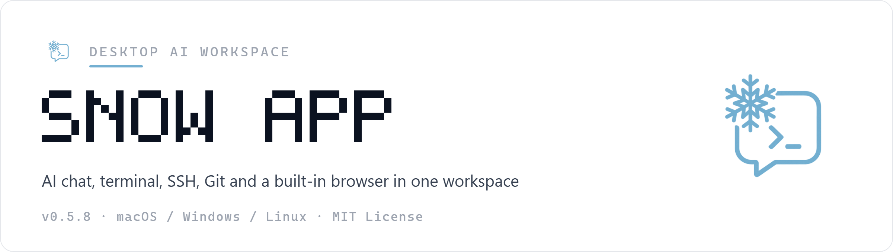
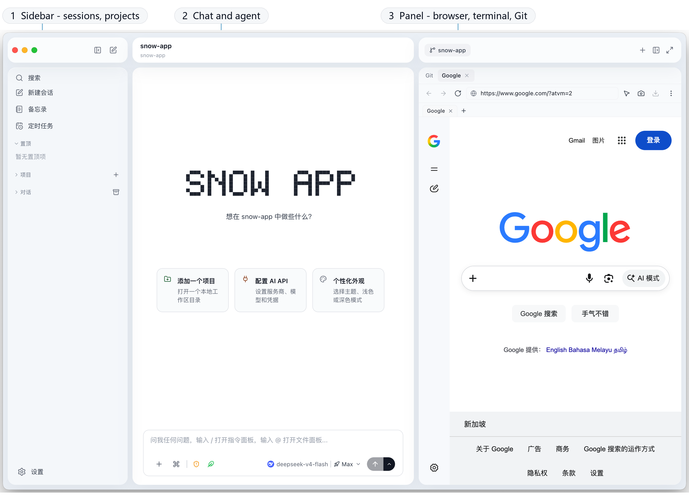
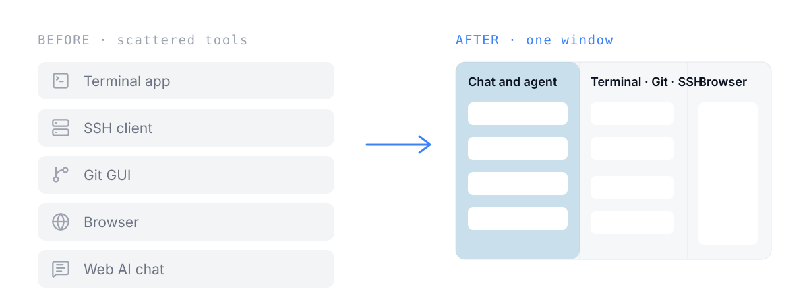
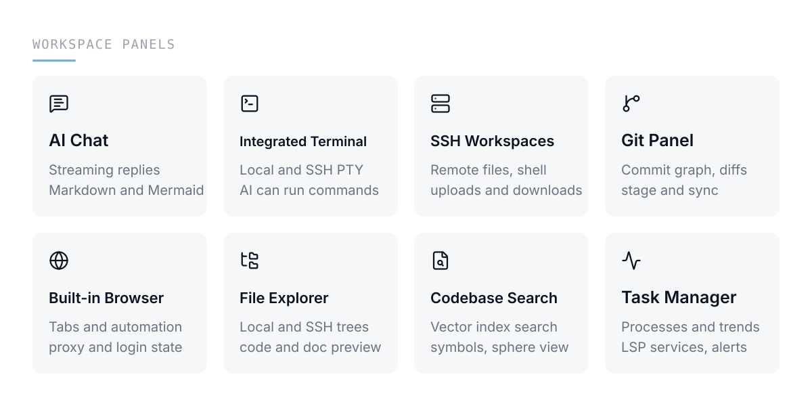
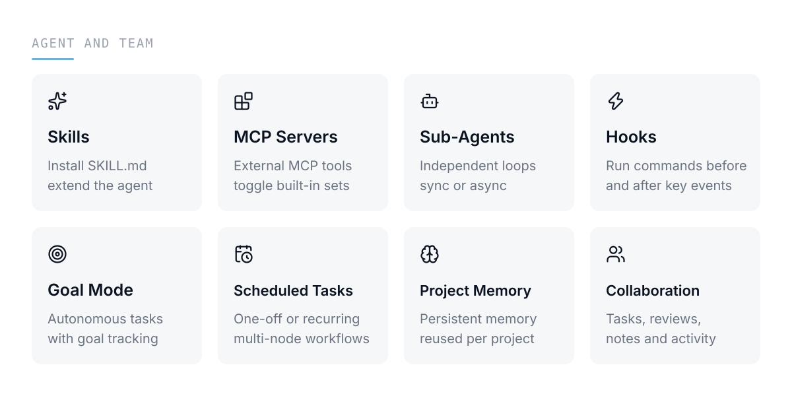
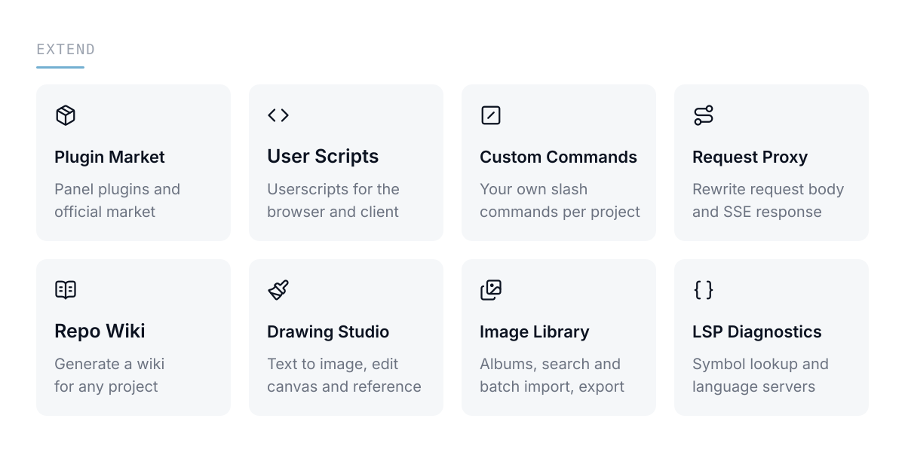
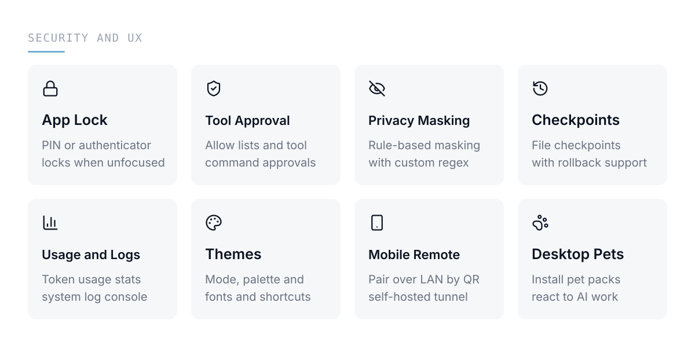
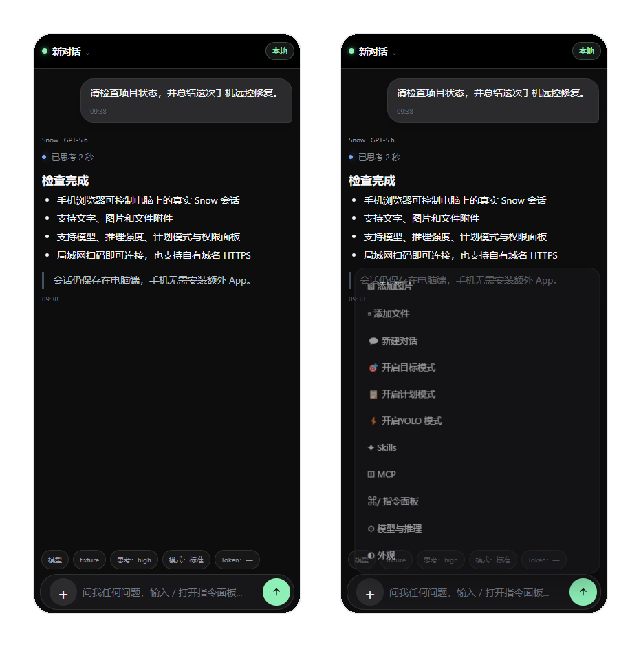

<p align="center">
  
</p>

<p align="center">
  <a href="https://github.com/xb0or/snow-app/releases"></a>
  
  
</p>

Snow App is a desktop workspace for developers: AI chat, an integrated terminal, SSH remote management, a Git panel and a built-in browser all live in one window, and the AI can drive them directly.

[中文文档](./README_zh.md)

## What it looks like

<p align="center">
  
</p>

## From five windows back to one workspace

<p align="center">
  
</p>

## What is inside

<p align="center">
  
</p>

These panels share one conversation context: the AI can read terminal output, browser pages and Git state directly, so nothing has to be copied between tools.

## Agent and team

<p align="center">
  
</p>

Skills, MCP servers, sub-agents and hooks are all pluggable; scheduled tasks support multi-node workflows, and project memory persists per project and is injected automatically.

## Extend and create

<p align="center">
  
</p>

Plugins, user scripts and the request proxy layer can rewrite the interface and the requests themselves; repo wiki, the drawing studio and the image library keep content work inside the same session.

## Security and experience

<p align="center">
  
</p>

Tool approval and privacy masking decide what the AI may do and see. App lock is off by default, covers the interface without encrypting disk data, and stores only a salted PIN hash.

## Continue on mobile

<p align="center">
  
</p>

Pair a phone from **Settings → Mobile Remote Control** and keep working from a mobile browser: switch workspaces and models, approve tools, answer questions, and send images or files. LAN pairing needs no cloud service; the optional public mode uses a self-hosted, authenticated TLS tunnel with one-time pairing, session revocation and sensitive-output redaction. See the [setup guide](docs/en/2-guides/23-mobile-public-remote-control.md).

## Requirements and first run

- **Node.js** >= 18
- **Rust** stable toolchain (builds the native module)
- **macOS**: Xcode Command Line Tools ｜ **Windows**: Visual Studio Build Tools (C++ workload) ｜ **Linux**: `build-essential`, `pkg-config`

```bash
npm install
npm run dev        # start in development mode with HMR
npm run build:app  # build a distributable package into release/
```

> **macOS users:** if the app reports "damaged" or "cannot be opened" after installation, run:
>
> ```bash
> sudo xattr -rd com.apple.quarantine /Applications/Snow\ App.app
> ```

## More

- Full documentation: [docs/](./docs/README.md)
- QQ group: 910298558
- Friendly link: [Linux DO](https://linux.do)
- License: [MIT](./LICENSE) · Copyright (c) 2026 MayMay
