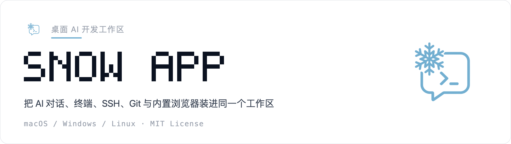
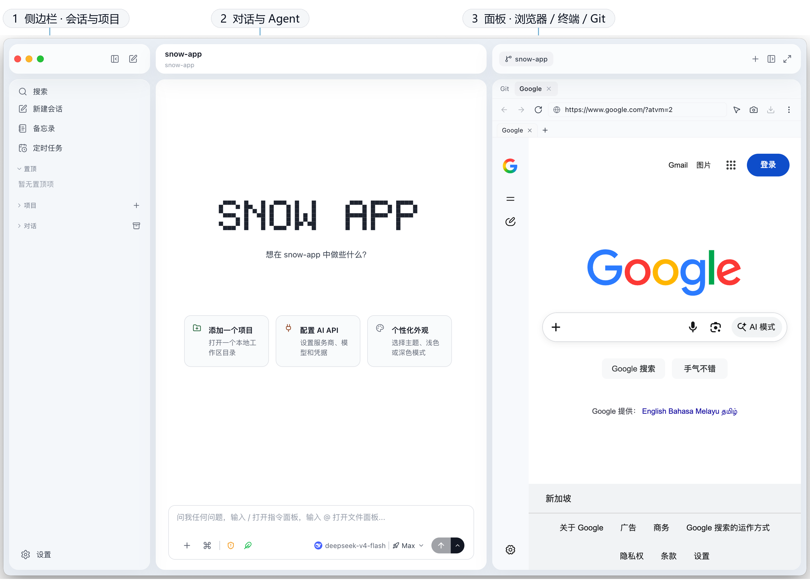
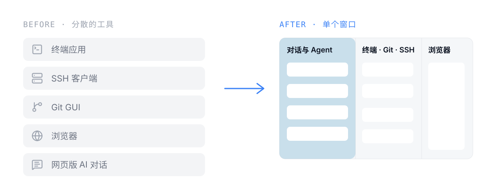
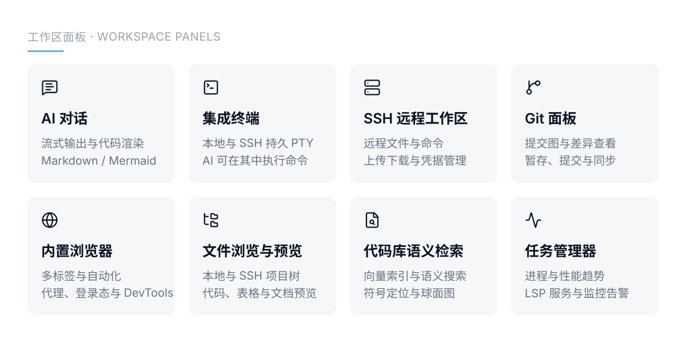
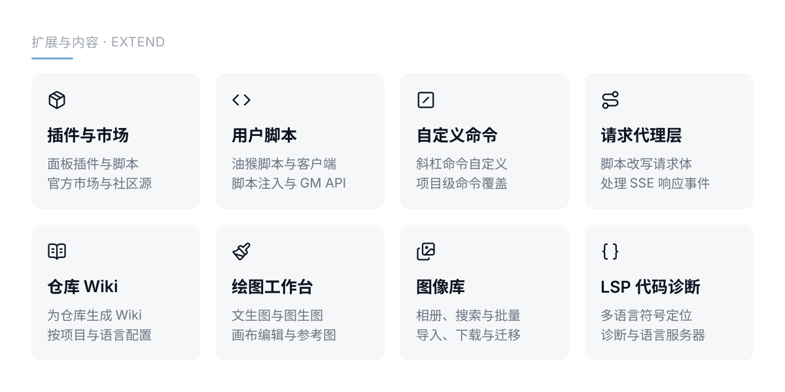
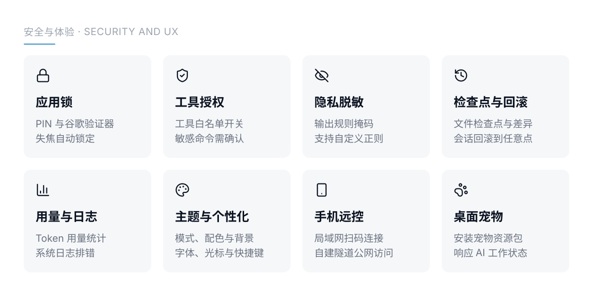

<p align="center">
  
</p>

<p align="center">
  <a href="https://github.com/MayDay-wpf/snow-app/releases"></a>
  
  
</p>

Snow App 是面向开发者的桌面工作区：AI 对话、集成终端、SSH 远程管理、Git 面板和内置浏览器都在同一个窗口里，AI 可以直接操作它们。

[English](./README.md)

## 安装后长什么样

<p align="center">
  
</p>

## 从五个窗口回到一个工作区

<p align="center">
  
</p>

## 一个窗口里有什么

<p align="center">
  
</p>

这些面板共享同一个会话上下文：AI 能直接读终端输出、浏览器页面和 Git 状态，不需要你在几个工具之间复制粘贴。

## Agent 与协作

<p align="center">
  
</p>

技能、MCP 服务器、子代理与 Hooks 都是可插拔的；定时任务支持多节点工作流，项目记忆按项目持久保存并自动注入。

## 扩展与内容

<p align="center">
  
</p>

插件、用户脚本和请求代理层能改写界面与请求本身；仓库 Wiki、绘图工作台和图像库让内容产出也留在会话里。

## 安全与体验

<p align="center">
  
</p>

工具授权与隐私脱敏决定 AI 能做什么、能看到什么；应用锁默认关闭，只遮盖界面而不加密磁盘数据，PIN 仅保存加盐哈希。

## 手机上继续

<p align="center">
  
</p>

在「设置 → 手机远控」完成配对后，可以用手机浏览器继续当前会话：切换工作区与模型、审批工具、回答问题、发送图片与文件。局域网模式不依赖云服务；可选的公网模式使用自建的 TLS 鉴权隧道，支持一次性配对、会话撤销与敏感输出脱敏。详见[手机远控指南](docs/zh-CN/2-使用指南/23-手机公网远控.md)。

## 环境与启动

- **Node.js** >= 18
- **Rust** stable 工具链（构建原生模块）
- **macOS**：Xcode Command Line Tools ｜ **Windows**：Visual Studio Build Tools（C++ 工作负载）｜ **Linux**：`build-essential`、`pkg-config`

```bash
npm install
npm run dev        # 开发模式启动，带热更新
npm run build:app  # 打包可分发安装包，输出到 release/
```

> **macOS 用户注意**：如果安装后打开提示「已损坏」或「无法打开」，在终端执行：
>
> ```bash
> sudo xattr -rd com.apple.quarantine /Applications/Snow\ App.app
> ```

## 更多

- 完整文档：[docs/](./docs/README.md)
- QQ 群：910298558
- 友情链接：[Linux DO](https://linux.do)
- 开源协议：[MIT](./LICENSE) · Copyright (c) 2026 MayMay
