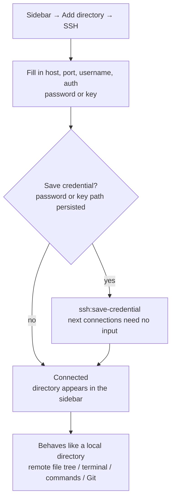

# 11-Terminal & SSH Remote Management

Snow App ships a built-in **terminal** (full PTY via node-pty + xterm.js) and
**SSH remote management**: local terminals can be opened in multiple tabs with
full interactivity; SSH directories mount as workspaces where files, terminal,
Git, and AI tools all operate through the remote channel — just like local.

## 1. Built-in Terminal

### 1.1 Opening a Terminal

| How            | Action                                                                                  |
| -------------- | --------------------------------------------------------------------------------------- |
| New terminal   | Right-click the right-panel tab bar → **New terminal** (multiple tabs)                  |
| In a directory | Right-click in the file viewer / Git panel / file list → **Open in terminal** (auto-cd) |
| From a project | Right-click a project tab in the top bar → Open terminal / browser / codebase           |
| From chat      | When the AI runs `bash-terminal-execute`, outputs offer "open in terminal"              |

### 1.2 Basics

- **Multiple tabs**: each tab is an independent PTY session;
- **Copy / Paste**: select text → copy button; paste button (handles bracketed
  paste correctly);
- **Link clicks**: URLs in terminal output open in the built-in browser tab;
- **Colors**: `ls --color`, git diff, and CLI outputs stay readable;
- **Key bindings**: follow Windows terminal conventions (e.g. `Ctrl+C`).

### 1.3 Working with the AI

`bash-terminal-execute` runs one command per invocation; on the PowerShell family
(pwsh / Windows PowerShell) consecutive commands reuse one persistent warm shell
session, so they no longer pay a fresh shell cold start each time (measured: ~400ms
→ ~40ms per trivial command). The working directory is still reset for every
command, while process-level state (environment variables, `$global:` variables)
persists between commands like in an interactive terminal, and commands that read
stdin (`Read-Host`, password prompts) must pass `isInteractive:true`. For
**long-running processes or interactive sessions** (e.g. `npm run dev`, vim, SSH
login) the AI uses an **interactive terminal session**:

- The AI opens a session and shows its live output in the conversation; you
  can type into it directly;
- Sessions are identified by UUID; the AI can `open` / `send` / `read` /
  `wait` / `resize` / `close` / `focus` / `list` multiple sessions;
- You can type passwords and confirmations into the session at any time.

## 2. SSH Remote Management

### 2.1 Adding an SSH Workspace

1. Sidebar → **Add directory → SSH**;
2. Fill in host, port, username, and auth (password or key);
3. Optionally **save the credential** (password or key path persisted via
   `ssh:save-credential`) so next connections need no input;
4. After connecting, the SSH directory appears in the sidebar and behaves
   exactly like a local one:
   - browse the remote file tree, open remote files in the reader;
   - open a terminal in the remote directory (remote shell);
   - filesystem tools read/write remote files; bash tools run remote commands;
   - open remote Git repositories (see below).

> `ssh://user@host:port/path` URLs are parsed and connected directly
> (`ssh:parse-url`); saved credentials can be listed/managed in the SSH
> management UI (`ssh:list-credentials`).
>
> **Jump host (ProxyJump)**: for a target machine behind a bastion, fill the
> wizard's **Jump host** field with an `~/.ssh/config` alias or
> `user@host:port`. Importing a `~/.ssh/config` host that declares `ProxyJump`
> prefills the jump chain automatically; the jump host uses the alias's
> `IdentityFile` when present, otherwise the SSH agent. One hop is supported,
> and the saved credential keeps the jump host so the workspace reconnects
> through it later (remote terminals add `-o ProxyJump` too).

### 2.2 Remote Git

Remote workspaces support Git just like local ones:

- Repository discovery and status (auto-discovers `ssh://` repos);
- Diff previews of remote changes, commits, pull/push;
- **Remote Git polling**: repositories without file-system watchers refresh
  automatically every 10 seconds.

### 2.3 Remote Commands & Files

- **Remote commands**: AI commands in a remote workspace route through the
  SSH channel (`remoteWorkspaceCommand`), same UX as local
  `bash-terminal-execute`;
- **Remote file ops**: filesystem tools transparently route `ssh://` paths to
  remote implementations (read, edit, create, search);
- **Session reuse**: `Ctrl+click` on remote paths in chat reuses the SSH
  connection per workspace.

### 2.4 Remote File Upload & Download

> Applies to: copying files between local and remote inside an SSH workspace (a
> one-off upload / download, not two-way sync).

#### Goal

Upload local files and fetch saved remote files inside an SSH workspace, and understand failures well enough to retry safely.

#### Steps

- **Upload to the workspace root**: click the **Upload files to the workspace root** button (`Upload` icon) in the SSH file-tree toolbar; the main process opens a multi-select file picker and uploads to the workspace root;
- **Upload into a specific directory**: right-click the target directory row → **Upload files here…**;
- **Drag-and-drop upload**: drag files from the OS onto a directory row or the empty tree area (the empty area targets the workspace root); the main process shows a confirmation dialog with the target directory and file count before the upload starts;
- **Download a single file**: right-click a remote file → **Download to local…**, then confirm the native save dialog opened by the main process;
- **Batch download**: select several remote files, right-click → **Download N files to local…** and pick one destination folder (no per-file save dialogs);
- **Download from the viewer**: click **Download to local** in the right-panel file-viewer header (SSH files only);
- **Remembered folder**: the folder used for a download is remembered and becomes the default next time.

> The viewer button fetches the **saved bytes of the remote original**; unsaved edits in the viewer are not included.

#### Transfers panel

The **File transfers** bar at the bottom of the explorer appears on demand: collapsed it shows the active / failed counts ("Transfers complete" once everything has finished), and expanded each row shows the direction (upload / download), file name, status, progress bar and byte counts. Tasks can be cancelled individually and the whole batch can be cancelled; once every task has finished a **Done** button appears that clears the finished records and dismisses the panel; a succeeded download offers **Show in folder**. A successful upload refreshes the affected remote directory automatically (a full refresh for the workspace root, invalidate-and-reload for subdirectories), once per task.

#### Verification

- The file appears in the local target folder, named after the remote file by default (invalid characters and reserved names are sanitized for the local platform);
- The uploaded file appears in the remote target directory without a manual refresh;
- The task advances through queued → preparing → transferring → verifying → committing → succeeded; an existing target enters "awaiting conflict" first.

#### Troubleshooting and recovery

- Cancelling the save dialog or a failed download creates no task and leaves the reader untouched — simply retry;
- Existing target: the transfers panel shows a negotiation card with **replace / skip / save-as / cancel this task**, plus an option to apply the same choice to the remaining conflicts;
- "The server does not support safe atomic replacement": save under a new name via **Save as** (see 2.5 Troubleshooting);
- A task showing "commit result unconfirmed": the connection dropped before the commit was confirmed, so the outcome is unknown — check the remote/local target file manually before retrying.

#### Behavior and limits

- **Original-file protection**: a random temporary file is written in the target's own directory and committed only after verification; the commit prefers the OpenSSH `posix-rename` atomic-replace extension, so existing files are never silently truncated or overwritten;
- **A server without safe atomic-replacement support fails explicitly** and suggests **Save as** instead of silently downgrading to a truncating write;
- **Conflicts**: when the target already exists you can choose replace / skip / save-as, with an option to apply the same choice to the remaining conflicts in the batch;
- **Change detection**: a source or target change (size / mtime) during the transfer cancels the commit; this is change detection only, not a consistent snapshot;
- **Cancellation**: cancelling a single task affects only that task; a whole batch can be cancelled together;
- **Honest states**: if the connection drops before the commit is confirmed the status is "commit result unconfirmed" and needs manual verification; there is no automatic retry;
- **Limits**: regular files only, no directory recursion yet; terminal drag-and-drop is unchanged (it still inserts path text and never uploads); a download saves a copy rather than syncing.

#### Implementation anchors

- `src/main/ssh/sshFileTransfer.ts`: transfer kernel (temp file, verification, atomic commit, change detection);
- `src/main/ssh/sshTransferManager.ts`: batch/task model, queue, cancellation, conflict negotiation, task-snapshot pushes;
- `src/main/ssh/sshTransferPrefs.ts`: remembers the last download directory;
- `src/main/ipc/handlers/sshHandlers.ts`: `ssh:transfers:*` IPC and the native dialogs;
- `src/preload/modules/sshApi.ts`: `sshTransferUpload` / `sshTransferUploadDropped` / `sshTransferDownload` / `sshCancelTransfer` / `sshResolveTransferConflict` / `onSshTransfersUpdated`;
- `src/renderer/components/rightPanel/ProjectExplorerContent.tsx`: toolbar upload, drag-and-drop upload onto directory rows and the empty tree area, and the directory refresh after a successful upload;
- `src/renderer/components/sidebar/ExplorerEntryContextMenu.tsx`: **Download to local…** for remote files, **Download N files to local…** for a multi-selection, and **Upload files here…** for directories;
- `src/renderer/components/rightPanel/SshTransfersPanel.tsx`: the file-transfers panel at the bottom of the explorer and the conflict-negotiation overlay;
- `src/renderer/components/rightPanel/FileViewerContent.tsx::handleDownloadRemote`: the **Download to local** button in the file-viewer header.

### 2.5 Troubleshooting

| Symptom                                               | Cause & fix                                                                                                                                     |
| ----------------------------------------------------- | ----------------------------------------------------------------------------------------------------------------------------------------------- |
| Connection timeout/failure                            | Check host/port and proxy settings (see [4-configure-proxy](4-configure-proxy.md))                                                              |
| Auth failure                                          | Check username and password/key path; keys must be standard OpenSSH format                                                                      |
| Remote Git stale                                      | Remote repos rely on polling (10s); wait or trigger a refresh                                                                                   |
| Garbled CJK in terminal                               | Ensure the remote locale is UTF-8 (`export LANG=en_US.UTF-8`)                                                                                   |
| "The server does not support safe atomic replacement" | The server lacks the OpenSSH atomic-replace extension; save the file under a new name instead                                                   |
| A task shows "commit result unconfirmed"              | The connection dropped before the commit was confirmed, so the outcome is unknown; verify the remote/local target file manually before retrying |

## 3. References

- Terminal settings (shell path, font, etc.): Settings → Terminal
  (`app-control-openSettings page=terminal-settings`)
  - **Unified shell**: The shell path in Terminal settings is the single
    authority for every command execution — the AI's `bash-terminal-execute`,
    lifecycle Hooks scripts, the Git panel (WSL scenarios) and the integrated
    terminal in the right panel all use this shell. When left empty, the
    system default terminal is auto-detected (Windows: PowerShell → CMD →
    Git Bash → COMSPEC; macOS/Linux: zsh → bash → fish → sh → `$SHELL`),
    and the AI commands and the integrated terminal resolve to the same result.
  - **Path validation**: Saving a non-empty shell path validates file
    existence — invalid paths are rejected. `terminal-open` also fails
    immediately when given a non-existent shell path instead of silently
    falling back to the default shell.
  - The network proxy field has been removed from Terminal settings (for
    proxy in terminal commands, configure `HTTP_PROXY`/`HTTPS_PROXY`
    environment variables in your shell).
- Git panel: [12-git-and-code-browsing](12-git-and-code-browsing.md)
