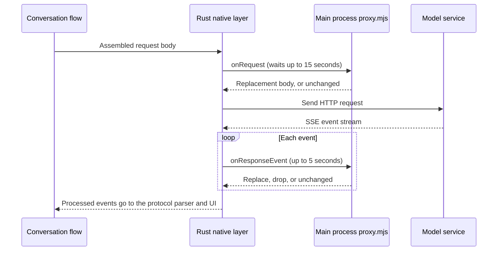

# Conversation Request Proxy: Rewriting Requests and Responses with a Script

> Applies to: Snow App desktop (Windows / macOS / Linux). The scope is model requests sent through the conversation stream (`createResponseStream`), including the main conversation, sub-agents, and context compaction. Title summaries, image generation, file-search agents, and codebase review do not pass through the proxy.

## Goal

- Before a model request body is sent, your script inspects, adds to, or replaces fields.
- Before each SSE event from the model is delivered to the app, your script can replace its text, rewrite its fields, or drop it.
- No app source changes are needed. Saving the script file takes effect without restarting.

## Prerequisites

- You can write JavaScript (ES modules). The script runs in the Electron main process with full Node.js privileges, so **only put trusted code in it**.
- No extra setting is required. The proxy is active whenever the script file exists and exports a hook.
- The request body contains the full conversation context, which the script can read. Do not write it to uncontrolled logs or send it over the network.

## How it works



The request stage runs once before each conversation request is sent. The response stage runs per event only when the script exports `onResponseEvent`. Without that export, responses are handled as usual with no extra overhead.

## Steps

1. Open the proxy script at `~/.snowapp/request-proxy/proxy.mjs` (on Windows, `C:\Users\<user>\.snowapp\request-proxy\proxy.mjs`). The app creates the file on first startup if it is missing.
2. By default the file is a template whose hooks are all commented out, so no request or response is changed. Uncomment the hook you need and edit it.
3. Save the file. The script reloads automatically when the next request or response event arrives; no restart is needed.
4. Send a message and confirm the effect with the [verification](#verification) methods below.

## Hook contract

The script is an ES module that recognizes two named exports. A hook that is not exported is equivalent to no processing.

| Export            | When it runs                                         | Argument                                                                                  | Return value and meaning                                                                                                                                                              |
| ----------------- | ---------------------------------------------------- | ----------------------------------------------------------------------------------------- | ------------------------------------------------------------------------------------------------------------------------------------------------------------------------------------- |
| `onRequest`       | Once before each conversation request is sent        | `{ body, context }`, where `body` is the request JSON for the current protocol            | Return an object: replace the whole request body. Return `undefined`: keep it unchanged.                                                                                              |
| `onResponseEvent` | Once per SSE event before it is delivered to the app | `{ event, context }`, where `event` is the raw event text without the trailing blank line | Return a string: replace this event with that text, which may contain several events separated by blank lines. Return `null`: drop this event. Return `undefined`: keep it unchanged. |

Fields of `context`:

| Field            | Type             | Meaning                                                                                                                                                   |
| ---------------- | ---------------- | --------------------------------------------------------------------------------------------------------------------------------------------------------- |
| `streamId`       | string           | Identifier of this conversation stream. All calls for the same reply share it.                                                                            |
| `conversationId` | string or `null` | Owning conversation. The first request of a new conversation may be `null`.                                                                               |
| `provider`       | string           | Protocol: `chat`, `responses`, `anthropic`, `gemini`, or `interactions`. Request bodies differ between protocols, so check this before changing anything. |

`context` does not include the endpoint URL, request headers, or the API key. The script cannot change where a request is sent and cannot read credentials.

## Examples

### Example 1: change the request body

Add one parameter to Chat Completions requests only and leave other protocols unchanged:

```js
export function onRequest({ body, context }) {
  if (context.provider !== "chat") return undefined;
  return { ...body, temperature: 0.2 };
}
```

Note: some reasoning models do not accept `temperature`, and the upstream returns HTTP 400. If you see that error, remove the field or limit the change to specific models.

### Example 2: replace text in a response (safe pattern)

Response events are JSON text. A plain string replacement over the whole event can break JSON escaping. Parse only the `data:` lines, modify the parsed object, and serialize it again:

```js
export function onResponseEvent({ event, context }) {
  if (context.provider !== "chat") return undefined;
  return event
    .split("\n")
    .map((line) => {
      if (!line.startsWith("data:")) return line;
      const raw = line.slice("data:".length).trim();
      if (raw === "" || raw === "[DONE]") return line;
      let data;
      try {
        data = JSON.parse(raw);
      } catch {
        return line;
      }
      const delta = data.choices?.[0]?.delta;
      if (typeof delta?.content === "string") {
        delta.content = delta.content.replaceAll("old phrase", "new phrase");
      }
      return `data: ${JSON.stringify(data)}`;
    })
    .join("\n");
}
```

Note: streamed output is split into fragments, so one word can span two events. A replacement inside a single event cannot match a word split across events. If you need whole-word replacement, constrain the output in `onRequest` or accept this limit.

### Example 3: drop a class of events

```js
export function onResponseEvent({ event, context }) {
  if (context.provider === "anthropic" && event.includes("event: ping")) {
    return null;
  }
  return undefined;
}
```

## Verification

- **Is the request changed?** Temporarily add `console.log(body)` inside `onRequest`. In development mode (`npm run dev`), the main-process `console` output appears in the terminal that started the app. Remove the line afterwards. Do not print whole request bodies in normal use.
- **Is the response changed?** Replace an easily recognizable word inside `onResponseEvent`, send a message, and check the UI.
- **Did the script load?** If the script has a syntax error or fails to import, it does not take effect. Requests and responses pass through unchanged, and the error is written to the application log (see the next section).

## Troubleshooting and recovery

| Symptom                                       | Cause                                                                                                                                                               | Action                                                                                           |
| --------------------------------------------- | ------------------------------------------------------------------------------------------------------------------------------------------------------------------- | ------------------------------------------------------------------------------------------------ |
| Changes have no effect                        | The hook is still commented out, the export name is misspelled (it must be `onRequest` or `onResponseEvent`), or the file was not saved.                            | Check that the export statement is uncommented, the name matches exactly, and the file is saved. |
| The application log shows a script load error | The script has a syntax error or throws at module top level.                                                                                                        | Fix the error and save. The next event reloads the script automatically.                         |
| Requests fail with HTTP 400                   | The field you added or changed is not accepted by that model.                                                                                                       | Remove the field, or limit the change by `context.provider` and model.                           |
| Response text breaks or is misplaced          | A replacement spans fragments split across events.                                                                                                                  | See the note in Example 2 and avoid whole-word replacement across events.                        |
| Responses become slow or replacement stops    | One event took more than 5 seconds to process, or the script does slow work. After a timeout, later events of that conversation are no longer passed to the script. | Keep hooks synchronous and fast. Do not wait for network requests inside a hook.                 |
| Requests wait for a long time before sending  | The request-stage script is slow. It waits up to 15 seconds, then sends the original body.                                                                          | Same as above.                                                                                   |
| You want the original behavior back           | You no longer need the proxy.                                                                                                                                       | Delete `proxy.mjs`, or comment out all hooks. Either change takes effect on the next request.    |

Application logs are described in [Usage statistics and system logs](20-usage-statistics-and-system-logs.md). Timeouts and call failures in the proxy layer are written by the Rust side with module `api` and function `request_proxy`. Exceptions thrown by the script and load errors are written by the main process with module `requestProxy`. Both appear in the application log.

## Behavior boundaries

| Situation                                                                                 | Behavior                                                                                                          |
| ----------------------------------------------------------------------------------------- | ----------------------------------------------------------------------------------------------------------------- |
| The script file does not exist, or exports no hook                                        | Requests and responses are completely unchanged.                                                                  |
| `onRequest` throws, returns a non-object, or times out                                    | The original request body is sent.                                                                                |
| `onResponseEvent` throws or returns something other than a string, `null`, or `undefined` | That event is passed through unchanged.                                                                           |
| `onResponseEvent` times out or the call fails                                             | That event is passed through unchanged, and later events of that conversation are no longer passed to the script. |
| The user presses stop                                                                     | Waiting hooks end immediately and the original data is passed through.                                            |
| A non-SSE response (a gateway returns a complete JSON body)                               | When the stream ends, the whole body is handed to `onResponseEvent` as one event.                                 |
| Events that are passed through                                                            | Re-emitted with standard blank-line separators between events.                                                    |
| Responses WebSocket transport (when `snowcfg.responsesWebSocket` is enabled)              | Does not pass through the proxy; requests and responses are sent directly.                                        |
| Title summaries, image generation, file-search agents, codebase review                    | Do not pass through the proxy.                                                                                    |

The script receives only the current request body and the current response event. The endpoint, request headers, and credentials are not part of it. The script runs in the main process and can access the file system and the network. This matches the boundary described in [Plugin development and installation](24-plugin-development-and-installation.md): local code runs with the app's privileges. For the security model, see [Security and trust boundaries](../3-reference/5-security-and-trust-boundaries.md).

## Implementation anchors

- `native/src/api/request_proxy.rs::transform_request`: request-body transformation, with timeout, cancellation, and pass-through on failure.
- `native/src/api/request_proxy.rs::wrap_response_stream`: splits the response byte stream into SSE events and hands each event to the script.
- `native/src/api/request_proxy.rs::with_session`: binds the conversation context to the conversation-stream future.
- `native/src/exports/api.rs::create_response_stream`: the conversation-stream entry point, which binds the session and passes the stream and conversation identifiers into the proxy layer.
- `native/src/api/chat/stream.rs::collect_chat_completions_stream`, and the `collect_*` functions of `anthropic`, `gemini`, `interactions`, and `responses`: the integration points for request transformation and response wrapping across the five protocols.
- `src/main/requestProxy/requestProxy.ts::registerRequestProxy`: registers the Rust callback, creates the template, and hot-reloads the script by modification time.
- `src/main/app/bootstrap.ts`: calls `registerRequestProxy` at application startup.
