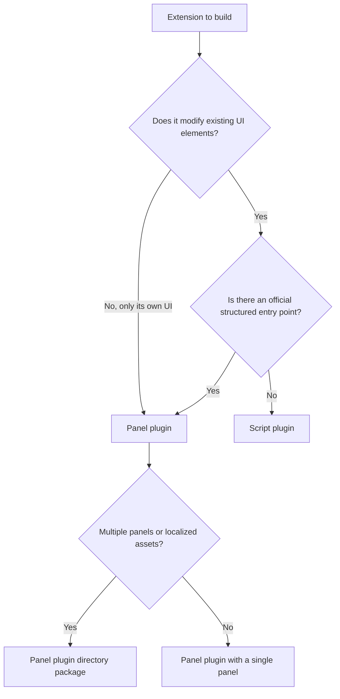

# 26-Plugin type selection guide (panel plugins vs client scripts)

> Applies to: Snow App desktop. This guide answers "which kind of extension should I build for Snow", covering the positioning of the two extension types, their capability boundaries, tie-breaking rules for overlapping scenarios, and permission differences. For concrete procedures see [22-Userscripts](22-userscripts.md) (script plugins) and [24-Plugin development and installation](24-plugin-development-and-installation.md) (panel plugins).

## Goals

- Decide whether a requirement means "own a dedicated area inside the app" or "modify the app's existing UI", and pick panel plugins or script plugins accordingly;
- Apply fixed tie-breaking rules in scenarios where both extension types can do the job (composer controls, message-area content), avoiding extensions that break on UI re-render;
- Know the irreplaceable capabilities and permission boundaries of each type, and combine them when necessary.

## Prerequisites

- Both extension types are managed on the sidebar **Plugins** page: the **Panel plugins** and **Script plugins** sub-tabs under **Plugin list** are their entry points;
- Before writing code, read the matching guide: script plugins in the "Client scripts (desktop window)" section of [22-Userscripts](22-userscripts.md), panel plugins in [24-Plugin development and installation](24-plugin-development-and-installation.md);
- Both types run as **local code** (in the renderer process or the page main world), so only install and author extensions from trusted sources.

## 1. Positioning in one sentence

| Extension type | Positioning                                                                                                                                                        | Typical output                                                                   |
| -------------- | ------------------------------------------------------------------------------------------------------------------------------------------------------------------ | -------------------------------------------------------------------------------- |
| Panel plugin   | **Own a dedicated area** inside the app: declare panels and let the host provide the container, theme, and localization, while the plugin renders freely inside it | Right-panel tab, composer toolbar entry, message footer card, tool-call card     |
| Script plugin  | **Modify the app's existing UI**: match by view and surface, then use native DOM to restyle, add controls, and hook into the interface                             | UI beautification, shortcut buttons, cross-origin requests, reuse of userscripts |

They are not two ways of doing the same thing: panel plugins cannot touch the host UI, and script plugins have neither a panel container nor a structured slot contract.

## 2. Capability comparison

| Dimension           | Panel plugin                                                                                                                                                                                         | Script plugin (client UI script)                                                                                                                                                     |
| ------------------- | ---------------------------------------------------------------------------------------------------------------------------------------------------------------------------------------------------- | ------------------------------------------------------------------------------------------------------------------------------------------------------------------------------------ |
| Form                | Local directory package: `plugin.json` plus an entry file                                                                                                                                            | Single Tampermonkey-compatible file (`// ==UserScript==` header)                                                                                                                     |
| Runtime             | `renderMode: "esm"` runs as an ES module in the main-window renderer; `renderMode: "iframe"` runs in a separate sandbox document                                                                     | Each script gets its own isolated world by default (sandboxed mode); declaring `@snow-sandbox false` or `@grant unsafeWindow` moves it to the page main world (full-permission mode) |
| UI capability       | Declares `panels` to provide panels; `messageFooters` takes over the message footer slot; `toolCallRenderers` takes over external MCP tool cards; `panels[].chatInput` adds a composer toolbar entry | After matching `@snow-view` / `@snow-surface`, operates on the DOM directly: `data-snow-anchor` anchors are read-only, `data-snow-slot` slots accept mounted nodes                   |
| Host rendering      | Panels and contribution points render inside the main React tree, keeping theme and i18n context                                                                                                     | Creates its own nodes; the host only cleans up used slots and `GM_addStyle` styles on unload                                                                                         |
| Data access         | `api.metadata` (36 read-only domains) and `api.write` (210 write actions, authorized per `scope` declaration)                                                                                        | `snow.metadata` / `snow.write`, sharing the same engine and rules as panel plugins, gated by `@snow-privacy`                                                                         |
| Unique capabilities | `api.ai` (ESM only, including prompt optimization and the two-phase safe draft flow), private `api.storage`, `api.assets` resolution, `locales` / `styles` declarations                              | The full `GM_*` set (persisted values, tabs, notifications, clipboard, menu commands), `snow.client` UI actions, zero-build edit-and-reload                                          |
| Network             | `api.net.fetch` (forwarded through the main process, requires the `network` declaration)                                                                                                             | `GM_xmlhttpRequest`, `snow.fetch`; in sandboxed mode the global `fetch` is already replaced by a CORS-free implementation                                                            |
| Distribution        | Directory package (zip as a release asset) or one-click install from the plugin market                                                                                                               | Single `.user.js` file, installable from a link, also compatible with `kind=script` market entries                                                                                   |
| Storage location    | `~/.snowapp/plugins/<pluginId>/` plus the `app_plugins` table                                                                                                                                        | `~/.snowapp/browser-script/{script_id}.user.js` plus the `userscripts` table (`target` is `client` or `all`)                                                                         |

> Both extension types share one metadata-domain and write-action engine (`api.metadata` with `snow.metadata`, and `api.write` with `snow.write`, both exposing 36 read-only domains and 210 write actions), so data capability is not a selection criterion. UI shape and rendering model are.

## 3. Tie-breaking rules for overlapping scenarios

In the scenarios below either type can work, but cost and stability differ a lot. Follow these rules:

| Requirement                                                                      | Preferred choice                                                 | Rationale                                                                                                                                                     |
| -------------------------------------------------------------------------------- | ---------------------------------------------------------------- | ------------------------------------------------------------------------------------------------------------------------------------------------------------- |
| A persistent composer button or dropdown that must read and write the chat draft | Panel plugin (`panels[].chatInput: true` plus `chatInputAction`) | The action runs inside the main React tree and uses host-managed draft tokens with a confirm / restore flow; scripts can only manipulate composer text        |
| A lightweight composer button that inserts fixed text                            | Script plugin slot `chat.input.actions`                          | Lowest implementation cost, and nodes appended to slots are cleaned up by the host on unload                                                                  |
| Append information under every AI reply                                          | Panel plugin `messageFooters`                                    | An official message-slot contract that mounts correctly with list virtualization; nodes appended by scripts are removed when virtualization rebuilds the list |
| Render a dedicated card for an external MCP tool                                 | Panel plugin `toolCallRenderers`                                 | Script plugins have no such capability                                                                                                                        |
| Call the app's built-in AI optimization                                          | Panel plugin `api.ai` (ESM only)                                 | Script plugins do not expose an `ai` capability                                                                                                               |
| Adjust overall visuals: hide elements, change colors, tune spacing               | Script plugin                                                    | Panel plugins render only inside their own container and cannot reach host DOM                                                                                |
| Insert simple controls into the top bar, sidebar, or message action row          | Script plugin slots                                              | Single file, zero build, effective immediately on save                                                                                                        |
| Quick experiments, or reuse Tampermonkey ecosystem scripts                       | Script plugin                                                    | Compatible metadata header and `GM_*`, installable directly from a link                                                                                       |
| Multiple panels, multiple locales, separate style files, private storage         | Panel plugin                                                     | The directory package provides `panels` / `locales` / `styles` / `api.storage`                                                                                |

The rule in one line: **wherever an official structured entry point exists, use a panel plugin; where none exists and the host UI must be modified directly, use a script plugin.**

## 4. Scenarios only one type can handle

| Only possible with | Scenario                                                                                                                                                                                     |
| ------------------ | -------------------------------------------------------------------------------------------------------------------------------------------------------------------------------------------- |
| Panel plugin       | Providing an openable panel; taking over message footers and tool-call cards; using the `api.ai` draft confirm flow; declaring locales and style files; using plugin-private storage         |
| Script plugin      | Modifying the app's overall appearance; inserting nodes into arbitrary host anchors / slots; reusing Tampermonkey scripts and `GM_*`; installing a single file without packaging a directory |

## 5. Combining both

Both types can be installed at once and act on the same UI without conflict: script plugins own the presentation layer (layout, visuals, shortcut entries) while panel plugins own the functional layer (data views, write operations, structured cards). When a script plugin needs to show complex data, prefer handing that data to a panel plugin for rendering instead of building a parallel UI inside the script.

## 6. Permission and security boundary comparison

| Dimension         | Panel plugin                                                                                                                                                                   | Script plugin                                                                                                                                     |
| ----------------- | ------------------------------------------------------------------------------------------------------------------------------------------------------------------------------ | ------------------------------------------------------------------------------------------------------------------------------------------------- |
| Default privilege | `esm` equals local renderer code (full privilege); `iframe` is a sandbox document that can only request `metadata` / `write` / `storage` / `assets` / `net` through the bridge | Sandboxed mode runs in an isolated world without `window.snow` or other app privileges; declaring the opt-out promotes it to full-permission mode |
| Data access       | Sensitive domains must be declared in the `privacy` field of `plugin.json`; otherwise access is denied (returns `denied`)                                                      | Sensitive domains must be declared in `@snow-privacy`; otherwise access is denied (returns `denied`)                                              |
| UI isolation      | Can only change its own container, so the host UI is unaffected by design                                                                                                      | Can change host DOM directly; nodes it modifies must be restored by the script in `snow.onCleanup`                                                |
| Failure impact    | An ESM plugin exception bubbles into the host render tree, so plugins should ship their own error boundary                                                                     | Errors are reported and counted; a script is **automatically disabled after 5 consecutive failures**                                              |

When the lowest risk is required, prefer the `iframe` render mode for panel plugins or sandboxed mode for script plugins. Full-permission mode (`esm` panels, main-world scripts) is equivalent to local code, so check the permission badge on the management page before enabling it.

## 7. Verification

1. Panel plugin: after installation, open its panel from the **plus menu** "Plugins" group or the right-panel tab system and confirm data and write operations work; `messageFooters` / `toolCallRenderers` contributions must be observed on the matching message or tool card.
2. Script plugin: after enabling it under **Plugin list → Script plugins**, switch to the view or surface the script declares and observe the UI change; errors are logged with the `[Snow Client Script]` prefix and counted as `errors n` in the list.
3. Confirm the UI recovers after disabling: a disabled panel plugin disappears from the entries, while a disabled script plugin has its slot content, `GM_addStyle` styles, and `snow.onCleanup` callbacks cleaned up by the host.

## 8. Troubleshooting and recovery

| Symptom                                                | Check                                                                                                                                                                     |
| ------------------------------------------------------ | ------------------------------------------------------------------------------------------------------------------------------------------------------------------------- |
| Both approaches work and the choice is unclear         | Go back to the rules in section 3: first check whether the target location has an official structured entry point                                                         |
| Nodes modified by a script disappear after a re-render | Expected. Re-attach with a `MutationObserver`, or switch to a panel plugin structured contribution point                                                                  |
| A script stops working after switching views           | Scripts without `@snow-scope global` unload when the view is left; declare `global` to stay resident, or rebuild in `snow.on('view-enter', ...)`                          |
| A sandboxed script cannot read `window.snow`           | Expected behavior; use `snow.metadata` / `snow.write` with an `@snow-privacy` declaration, and only escalate to full-permission mode when raw privilege is truly required |
| A script was disabled automatically                    | Triggered by 5 consecutive failures; fix it and enable it manually again                                                                                                  |
| A panel plugin's panel does not appear                 | Confirm the plugin is enabled and look in the plus menu "Plugins" group; after editing `plugin.json`, use "reload manifest"                                               |

## Implementation anchors

- Panel plugin manifest parsing (`panels` / `messageFooters` / `toolCallRenderers` / `chatInput` contribution points): `src/renderer/plugins/manifest.ts::normalizePanels`, `::normalizeMessageFooters`, `::normalizeToolCallRenderers`
- Panel plugin runtime API (`metadata` / `write` / `storage` / `ai` / `net` / `assets` / `ui`): `src/renderer/plugins/pluginApi.ts::createPluginApi`
- Read-only metadata domain definitions: `src/renderer/plugins/metadata/domains.ts`; write action definitions and authorization checks: `src/renderer/plugins/writes/index.ts::executeWrite`
- iframe panel bridge: `src/renderer/plugins/pluginIframeBridge.js`; panel host: `src/renderer/components/rightPanel/PluginPanelContent.tsx`
- Script plugin host (isolated-world injection, `GM_*` and `snow` shims, anchors and slots, cleanup): `src/preload/clientScriptHost.ts::initClientScriptHost`
- Script plugin matching and push: `src/main/app/userscriptSyncStore.ts::matchesClientContext`, `::applyClientScripts`
- Script metadata parsing (`@snow-target` / `@snow-view` / `@snow-surface` / `@snow-scope` / `@snow-sandbox` / `@snow-privacy`): `native/src/storage/userscripts.rs::parse_meta`
- Management UI: `src/renderer/components/sidebar/PluginsPanel.tsx`, `src/renderer/components/sidebar/PluginScriptsSection.tsx`
