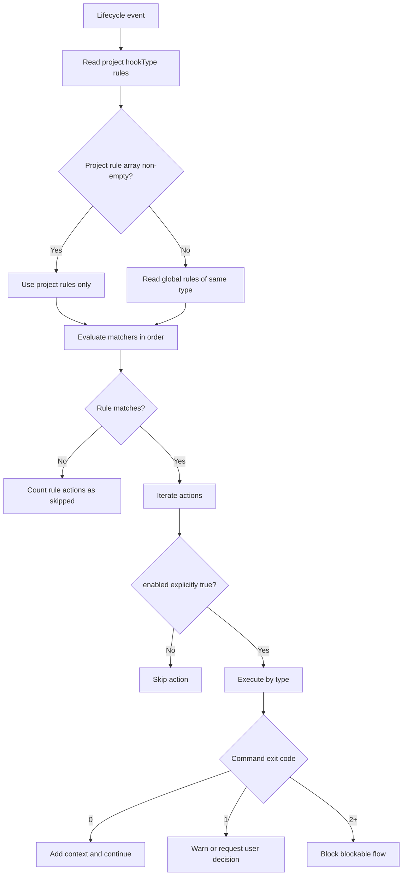
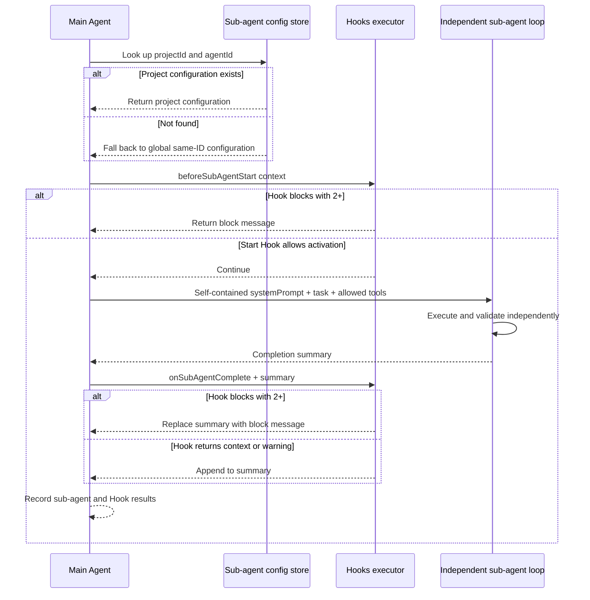

# 5-Configure Hooks and Sub-agents

Snow App stores Hooks and sub-agent configuration in the app SQLite database, shared with the Settings UI. The Agent can read and write it through the built-in `config` service, and successful changes take effect immediately.

## 1. Hooks

### 1.1 Scope and effective rules

- A global Hook is available to all projects; a project Hook requires `projectId`;
- For a `hookType`, Snow App uses the project's rules when that array is **non-empty**; otherwise it falls back to the global rules of the same type;
- Project and global rules are not merged. A non-empty project array suppresses global fallback even when every action in it is disabled;
- An action runs only when **`enabled` is explicitly `true`**. Missing, `null`, and `false` all mean skipped. The Settings UI writes this field explicitly; hand-written config must do the same.

### 1.2 Hook types

| `hookType`            | Trigger                                                     | Allowed actions      |
| --------------------- | ----------------------------------------------------------- | -------------------- |
| `onUserMessage`       | Before a user message reaches the AI                        | `command`, `context` |
| `beforeToolCall`      | Before a tool call                                          | `command`            |
| `toolConfirmation`    | When a tool enters confirmation                             | `command`            |
| `afterToolCall`       | After a tool call completes                                 | `command`            |
| `onSubAgentComplete`  | After a sub-agent completes                                 | `command`, `prompt`  |
| `beforeSubAgentStart` | Before a sub-agent starts                                   | `command`, `context` |
| `beforeCompress`      | Before context compaction                                   | `command`            |
| `onSessionStart`      | When an existing conversation opens; fire-and-forget        | `command`, `context` |
| `onStop`              | When a conversation stops or is cleaned up; fire-and-forget | `command`, `prompt`  |

> `prompt` is a valid configuration type, but the current native executor does not make a model call; it returns an unsupported failure record. Do not depend on a `prompt` action for production automation. Prefer a verifiable `command`, or `context` where allowed. A `beforeSubAgentStart` context result is currently recorded but is not appended to the child agent prompt by the caller.

### 1.3 Rule and action fields

```json
{
  "description": "Inject project policy into release checks",
  "matcher": "toolName:bash-*",
  "hooks": [
    {
      "type": "command",
      "command": "node scripts/check-release.mjs",
      "timeout": 5000,
      "enabled": true
    }
  ]
}
```

| Field         | Location | Meaning                                                                                                                                           |
| ------------- | -------- | ------------------------------------------------------------------------------------------------------------------------------------------------- |
| `description` | rule     | Must be present; describe intent and failure impact.                                                                                              |
| `matcher`     | rule     | Optional. Commas mean OR; `key:glob` is supported, such as `toolName:bash-*`. Without a key, matching checks `toolName` first, then context text. |
| `hooks`       | rule     | Required action array.                                                                                                                            |
| `type`        | action   | `command`, `context`, or `prompt` where allowed.                                                                                                  |
| `command`     | command  | Runs through the shell selected in terminal settings.                                                                                             |
| `content`     | context  | Static text. JSON fields `additionalContext` or `prompt` are extracted; otherwise the whole text is used.                                         |
| `prompt`      | prompt   | The current native executor does not run a model call.                                                                                            |
| `timeout`     | command  | Milliseconds; defaults to `5000`. Timeout kills the child and returns an error.                                                                   |
| `enabled`     | action   | **Must be `true` to execute**; missing means skipped.                                                                                             |

A command receives event context JSON on stdin and uses `cwd` from context when present. stdout/stderr are interpreted by exit code:

| Exit code                  | Result                                                                                                                 |
| -------------------------- | ---------------------------------------------------------------------------------------------------------------------- |
| `0`                        | Pass; non-empty stdout becomes additional context. JSON stdout can supply `additionalContext` or `prompt`.             |
| `1`                        | Soft warning and warning log. stdout shaped as `{"decision":{"message":"..."}}` requests an interactive user decision. |
| `2+` or no valid exit code | Block the current blockable flow, preferring stderr and then stdout as the message.                                    |

`onSessionStart` and `onStop` are fire-and-forget. Their caller downgrades interactive decisions to ordinary warnings, so they cannot be relied on to block a flow.

### 1.4 Hook execution flow



### 1.5 Configure in the UI

1. Open **Settings → Hooks Settings** (settings page id: `hooks-settings`);
2. Select Global or Project scope;
3. Choose a `hookType`, then add rules and actions;
4. Ensure the toggle is on for every action that should run;
5. Save and test with a low-risk event;
6. Inspect Hook execution records and app logs.

### 1.6 Configure through `config`

Global command Hook:

```jsonc
config-set scope=hooks key=beforeToolCall value={
  "rules": [
    {
      "description": "Run read-only tool auditing",
      "matcher": "toolName:filesystem-*",
      "hooks": [
        {
          "type": "command",
          "command": "node scripts/audit-tool-call.mjs",
          "timeout": 5000,
          "enabled": true
        }
      ]
    }
  ]
}
```

Project context Hook:

```jsonc
config-set scope=hooks key=onUserMessage projectId=<projectId> value={
  "rules": [
    {
      "description": "Inject this project's technology stack",
      "hooks": [
        {
          "type": "context",
          "content": "This project uses Electron, React, TypeScript, and Rust.",
          "enabled": true
        }
      ]
    }
  ]
}
```

When there are multiple actions, set `enabled` explicitly on each one:

```json
{
  "rules": [
    {
      "description": "Check and record context before compaction",
      "hooks": [
        {
          "type": "command",
          "command": "node scripts/check-context.mjs",
          "timeout": 5000,
          "enabled": true
        },
        {
          "type": "command",
          "command": "node scripts/write-audit.mjs",
          "timeout": 5000,
          "enabled": false
        }
      ]
    }
  ]
}
```

Recommended flow:

1. Run `config-list scope=hooks projectId=<projectId>` and read the current state and `guidance`;
2. Preserve the current value with `config-get scope=hooks key=<hookType> projectId=<projectId>`;
3. Write the complete `rules` value with `config-set`;
4. Immediately read it back and inspect every `enabled` field;
5. Test matcher and exit-code behavior with a low-risk event;
6. Before `config-delete`, show the scope, key, projectId, and impact and obtain explicit confirmation.

Hook database writes create a temporary backup during the operation and remove it after success. It is not persistent history.

## 2. Sub-agents

### 2.1 Fields and scope

A sub-agent runs through `sub-agents-activate` in an independent execution loop with no main-conversation history. Configuration fields:

| Field           | Meaning                                                                                                                                                                                                                                                   |
| --------------- | --------------------------------------------------------------------------------------------------------------------------------------------------------------------------------------------------------------------------------------------------------- |
| `name`          | Required display name.                                                                                                                                                                                                                                    |
| `description`   | Tells the main Agent when to delegate.                                                                                                                                                                                                                    |
| `systemPrompt`  | Must be self-contained: mission, inputs, workflow, tools, safety, and output.                                                                                                                                                                             |
| `toolsJson`     | JSON string or tool-name array. `["*"]` means every tool available in the current project. An explicit list must include at least one read tool (`filesystem-read` or `grep-search`); an empty array is rejected.                                         |
| `configProfile` | Empty inherits the API profile and current model used by the parent conversation's current run; non-empty pins the named profile.                                                                                                                         |
| `model`         | Applies only with a pinned profile. A non-empty value pins the model; an omitted, empty, or trim-empty value uses that profile's `advancedModel`. If that profile's `advancedModel` is also empty, activation fails; it never falls back to `basicModel`. |

Activation looks up the current project's same-ID configuration first and falls back to global only when it is absent. Built-in `agent_general` cannot be modified or deleted through config.

The main agent's system prompt now **dynamically injects the list of available sub-agents** (with `agentId`, name, and purpose description). When calling `sub-agents-activate`, the main agent must pick the `agentId` that best matches the task from that list — it must **not default to the built-in `agent_general`** when a more specific agent is configured (the built-in remains a generic fallback). The list follows the same resolution rules as activation: **project-scoped sub-agents of the current project come first** and override the global one on the same `agentId`; agents without a project-level config fall back to global/built-in. Sub-agents of other projects are not injected. New sessions pick up configuration changes immediately.

Before creating a sub-session, Snow validates the tool-list format, profile, and model once and creates a runtime snapshot. The normal loop, recursive tool loop, automatic compaction, and post-compaction resume all reuse that snapshot instead of following later global changes. Each request still reloads current credentials by the fixed profile name, but deleting that profile causes a strict failure rather than switching providers. The sub-session persists the profile and model actually selected at startup, so history display is not affected by later sub-agent or API configuration edits.

Tool rules:

- When `projectId` is omitted in a project conversation, the current project is used, which makes the sub-agent project-scoped. To create a **global** sub-agent, pass `projectId=""` explicitly;
- A global sub-agent's explicit tool list draws its candidates from system and global MCP servers, independent of any project, so you do not need to select a project first. A project sub-agent's candidates are the tools enabled for that project;
- `["*"]` expands at runtime to every tool available in the current project;
- An explicit list must include `filesystem-read` or `grep-search`, otherwise saving fails;
- A project-scoped sub-agent written through config must name built-in tools or tools from configured, enabled MCP servers; global sub-agents skip project validation;
- At runtime only tools actually available in the current conversation's project are used. Configured tools that are globally or project-disabled, unavailable, or missing are skipped and logged. The sub-agent continues with the remaining tools; it does not fail and does not gain extra permissions.

### 2.2 Sub-agent Conversation View

A sub-agent runs in its own conversation. Opening it shows:

- **Header title**: displays the **stage name** (the prompt truncated to 80 characters at activation — the task stage the sub-agent was spawned for) instead of the project name; the subtitle notes **which main conversation launched it**;
- **Info card**: above the message list, an `agentName` badge, the stage title, a **jump back to the main conversation** button, and the **full prompt** (clamped to 3 lines by default; hovering shows the whole text);
- **Data sources**: the conversation record's `title` / `subAgentName`, the first user message (the prompt), and the parent conversation's title (fetched asynchronously).

### 2.3 Configure in the UI

1. Open **Settings → Sub-agent Settings** (settings page id: `sub-agent-settings`);
2. Select Global or Project scope;
3. Enter the name, description, and a complete system prompt;
4. In the MCP tools list, check at least one read tool (`filesystem-read` or `grep-search`). The Global tab lists tools from system and global MCP servers, independent of the current project, so you do not need to select a project first. The Project tab lists only tools enabled for the current project. The UI has no all-tools switch; write `["*"]` through config;
5. Keep **Follow the parent conversation (recommended)**, or select a pinned API profile. With a pinned profile, optionally select an independent model; leaving it empty uses the profile's advanced model;
6. Save, then delegate one narrowly scoped test task from the main conversation.

### 2.4 Configure through `config`

Global sub-agent example (`projectId=""` means global):

```jsonc
config-set scope=subAgents key=agent_readonly_reviewer projectId="" value={
  "name": "Read-only Reviewer",
  "description": "Use for an independent review and issue list",
  "systemPrompt": "You are a read-only reviewer. Verify inputs and files first, then report issues and evidence by severity. Never modify files, run commands, or guess missing business rules. If a tool is unavailable, identify what cannot be verified.",
  "toolsJson": ["filesystem-read", "grep-search"],
  "configProfile": "",
  "model": ""
}
```

Project-scoped explicit tools:

```jsonc
config-set scope=subAgents key=agent_project_reviewer projectId=<projectId> value={
  "name": "Project Reviewer",
  "description": "Review the current project and return findings with paths",
  "systemPrompt": "You are this project's read-only code reviewer. Use allowed tools to establish facts. Report severity, file path, evidence, and remediation. Never modify files.",
  "toolsJson": [
    "filesystem-read",
    "grep-search",
    "lsp-symbols"
  ],
  "configProfile": "",
  "model": ""
}
```

Before writing, run `config-list scope=subAgents projectId=<projectId>` to obtain guidance and the current tool environment. Read back with `config-get` after writing. `config-delete` also requires explicit user confirmation.

### 2.5 Sub-agent and Hooks sequence



If the `beforeSubAgentStart` call throws, acceptance fails: the sub-agent is not started and no accepted receipt is returned. Normally returned Hook decisions retain the existing exit-code semantics; security gates should explicitly return `2+` to block rather than relying on an exception as a decision.

### 2.6 Sub-agent session resume and same-session communication

- **Recovery and explicit continuation**: the host rebuilds a bounded factual identity ledger with conversation/run/task, state, mode and result locations, without a model list call. Restart marks nonterminal runs interrupted and never replays them. Explicit continue creates a new run; historical facts grant no new authority. A persisted run/snapshot is required for continuation.
- **Opt-in collaboration**: children do not carry communication tools by default. Configured sendMessage capability (or the built-in wildcard) must intersect an explicit collaborationGroup on this delegation. The host supplies authorized same-task/group recipientRunIds, not discovery through listTeammates or a guessed latest generation.
- **Messages and isolation**: reuse durable message storage and idempotent requests, checking project, parent, task, group and exact sender/recipient runs. Finalizing/cancelling/terminal runs reject new messages. Queued is not understood; termination reports unconsumed input as undelivered without silently forwarding it to a replacement run.

### 2.7 Current durable execution: sync and async

Choose the default execution mode under Settings → Sub-agent Settings → Run limits (synchronous by default). The setting is only a default: `activate` / `continue` accept an optional `executionMode` argument (`sync` / `async`), so the AI can pick the mode per dispatch and the setting applies only when the argument is omitted. Sync waits for a terminal result envelope; async returns an accepted receipt. Sub-agents inside Workflow nodes are synchronous only: the node's tool schema offers `sync` alone and an explicit `async` is rejected. Continue against an active target returns message_queued without changing that run's mode.

Both modes require a project/workspace-bound ordinary desktop parent or registered detached conversation window. They share acceptance, transitions, settlement and paging. Unbound and Workflow nondurable sub-agent execution is unsupported. Old child conversations without a run/snapshot cannot resume or reconstruct execution from old messages/current settings. Runs do not continue after application exit.

Only five public tools remain. wait, listSubAgents and listTeammates have no registration or specialized parsing. Old tool records retain generic raw display; historical data is not deleted.

| Tool                   | Parameters and behavior                                                                                                                                                                                     |
| ---------------------- | ----------------------------------------------------------------------------------------------------------------------------------------------------------------------------------------------------------- |
| sub-agents-activate    | agentId, summary, prompt; optional requestId, acceptance and collaborationGroup. Communication requires the intersection of this explicit grant and configured capability.                                  |
| sub-agents-continue    | conversationId, message; optional requestId, acceptance and collaborationGroup. Queue only to an exact active generation or explicitly start a terminal continuation; reject finalizing/cancelling targets. |
| sub-agents-getResult   | runId, offset and limit; read terminal content/pages, never progress. Default16000 Unicode characters, limit1–64000.                                                                                        |
| sub-agents-cancel      | runId; preserve requested/confirmed/already_terminal/too_late and existing external effects.                                                                                                                |
| sub-agents-sendMessage | recipientRunId, message, optional requestId. Use current host-authorized collaborator identities, not the old conversationId alias.                                                                         |

Select async in settings before submitting this activate request:

```json
{
  "agentId": "agent_general",
  "summary": "Read-only project check",
  "prompt": "Only read this project's package.json and summarize its build commands. Do not run commands or modify files."
}
```

accepted/message_queued does not prove completion, consumption or understanding. Current receipts require the actual executionMode. Sync terminal results and getResult use result.run.outcome, not the old flattened summary envelope. Errors, acceptance, cancellation attribution and unconsumed input remain in outcome and survive summary pagination.

requestId identifies one logical operation. Unknown-receipt retries reuse the same ID and business input; settings changes do not reinterpret admitted mode or duplicate dispatch. Use a new ID only for a new operation. Current global/project configuration precedence remains unchanged.

A busy parent admits results at a complete tool boundary. An idle parent may receive an internal round only while the original task is open. Stop, close or new user input never revives an old task. Internal results are not user authorization or Plan approval; UI reads do not receive events or acknowledge wakes. Sync and observed getResult deduplicate by exact event identity. Internal event-based sync waiting remains, but no public wait tool exists.

Restart/owner loss marks nonterminal runs interrupted, not user-cancelled, with no replay. Archive retains complete identities without reopening tasks. Delete/rollback retain admission gates, cancellation and owner drain. After filesystem restoration begins, rollback requires explicit recovery/retry rather than a no-effects claim.

Native serializes global capacity in one transaction, without the old renderer semaphore. Default budgets are128 model requests and30 active minutes, excluding authorization/input/pause waits. Exhaustion is failure. Cancellation does not undo prior external effects. Cross-database peer endpoints require restoring related archives before retrying, never silently omitting effects.

For diagnosis record time and runId/eventId/interactionId, then inspect sub-agents acceptance/execution/settlement/receipt/wakeup logs. Do not share secrets or full sensitive prompts. A successful build does not mean the frozen preview loaded these sources.

### 2.8 Evidence boundaries and cancellation attribution

- `summary` is the final turn body, not a full transcript. Open the child conversation for intermediate per-file reports. Unicode-character pagination slices that final body only; it cannot recover earlier turns absent from it.
- Host acceptance checks establish that evidence IDs belong to the child execution log, not semantic relevance or business correctness. The parent must inspect real tool status and directly relevant content instead of using a successful read to support unrelated claims.
- New cancellations may include `cancellation: {source, requestedAt}` in synchronous final outcomes, async getResult, cancel receipts and logs. Sources distinguish `cancel_tool`, `parent_stop`, `conversation_stop`, `ui_cancel`, `deletion`, `runtime_abort` and `unspecified`. Rust captures UTC epoch milliseconds at first durable acceptance. Retries preserve attribution; already_terminal/too_late never add or replace it. Missing legacy metadata means unrecorded, not an inferred parent or user action. The public cancel tool still accepts only runId; the model cannot specify attribution.
- message_queued proves queuing only. Run-event deliveryStatus=received proves durable incorporation into parent input only. Neither acknowledges model understanding of a queued message. Separate activate calls create independent conversations, not a same-target RUN_BUSY test.

New metadata requires loading the new native/renderer; builds and isolated probes do not replace live restart, cross-window or deletion acceptance.

## 3. Validation and troubleshooting

| Symptom                                                                 | Check                                                                                                                                                                            |
| ----------------------------------------------------------------------- | -------------------------------------------------------------------------------------------------------------------------------------------------------------------------------- |
| Hook saves but never runs                                               | Ensure the action explicitly has `"enabled": true`; a missing value is skipped by the native executor.                                                                           |
| Project Hook does not fall back globally                                | A non-empty project array replaces global rules; delete the project config or use an empty rule array to fall back.                                                              |
| Matcher does not match                                                  | Verify context keys and full tool name; use `toolName:<glob>` when appropriate.                                                                                                  |
| Command times out                                                       | Default is 5000 ms; inspect shell, PATH, cwd, stdin handling, and a reasonable positive `timeout`.                                                                               |
| Exit 1 shows no decision card                                           | stdout must be valid JSON with a string `decision.message`; fire-and-forget Hooks only show a warning.                                                                           |
| Prompt action has no effect                                             | The current native executor does not execute prompt model calls; use command or supported context.                                                                               |
| Context does not reach the child prompt                                 | `beforeSubAgentStart` currently records context but does not append it to the child prompt; put required content in `systemPrompt`.                                              |
| Saving a sub-agent is rejected (empty list or no read tool)             | Include `filesystem-read` or `grep-search` in an explicit list, or use `["*"]` for every available tool.                                                                         |
| A sub-agent stops using a service's tools after the project disables it | Runtime skips tools disabled for the current conversation's project and logs them. Re-enable the service in that project to restore them; the global configuration is unchanged. |
| A global sub-agent cannot find a project-owned service's tool           | The Global tab lists only system and global MCP server tools. Use a project-scoped sub-agent for project-owned services.                                                         |
| Sub-agent cannot find a tool                                            | Use the exact project-enabled full tool name and inspect MCP server and tool toggles (global + project).                                                                         |
| Sub-agent depends on main conversation                                  | It has no main history; place context in the task prompt or self-contained `systemPrompt`.                                                                                       |
| Wrong same-ID config activates                                          | Project scope wins over global; query both scopes and verify `projectId`.                                                                                                        |
