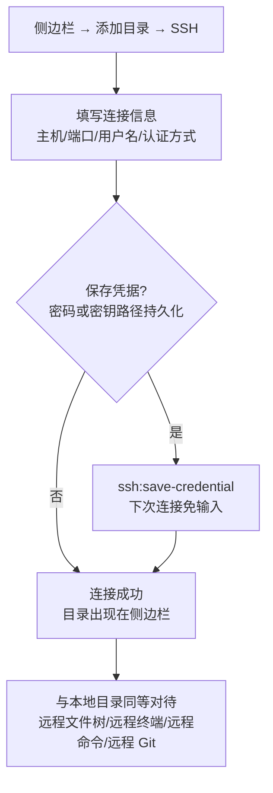

# 11-终端与SSH远程管理

Snow App 内置**终端**（基于 node-pty + xterm.js 的完整 PTY 终端）与
**SSH 远程管理**：本地终端可多开、可交互；SSH 目录作为工作区挂载，
文件操作、终端、Git、AI 工具全部走远程通道，与本地体验一致。

## 1. 内置终端

### 1.1 打开终端

| 方式         | 操作                                                                                 |
| ------------ | ------------------------------------------------------------------------------------ |
| 新建终端     | 右侧面板右键 → **新建终端**（可开多个标签）                                          |
| 在目录打开   | 文件阅读器 / Git 面板 / 文件列表右键 → **在终端中打开**（自动 cd 到该目录）          |
| 项目快速打开 | 顶部项目标签右键 → 打开终端 / 浏览器 / 代码库                                        |
| 会话中打开   | 聊天中输入 `/` 命令或让 AI 调用 `bash-terminal-execute` 时，输出可一键"在终端中打开" |

### 1.2 基本操作

- **多标签**：每个终端标签独立 PTY 会话，可同时运行；
- **复制 / 粘贴**：终端内选中文本 → 复制按钮；粘贴按钮（正确处理
  bracketed paste）；
- **链接点击**：终端输出中的 URL 点击后在内置浏览器 tab 打开；
- **颜色与排版**：`ls --color`、git diff 等彩色输出保持可读；
- **键位**：遵循 Windows 终端惯例（如 `Ctrl+C` 中断等）。

### 1.3 与 AI 的配合

AI 的 `bash-terminal-execute` 每次执行独立命令；PowerShell 家族（pwsh / Windows
PowerShell）会在后台复用一个常驻热 shell 会话，连续命令无需重复承担冷启动开销
（实测单条从 ~400ms 降到 ~40ms），每条命令仍会重置工作目录，而进程级状态
（环境变量、`$global:` 变量）像交互终端一样在命令间保留；命令需要 stdin 输入
（`Read-Host`、密码提示等）时必须走 `isInteractive:true`。需要**长驻进程或
交互式会话**（如 `npm run dev`、vim、SSH 登录）时，AI 会使用
**交互式终端会话**：

- AI 打开交互会话后会实时展示终端画面，用户可直接在其中输入内容；
- 会话通过 UUID 标识，AI 可执行 `open` / `send` / `read` / `wait` /
  `resize` / `close` / `focus` / `list` 等操作管理多个会话；
- 用户也可以随时在会话中输入密码、确认提示等。

## 2. SSH 远程管理

### 2.1 添加 SSH 工作区

1. 侧边栏 → **添加目录 → SSH**；
2. 填写连接信息（主机、端口、用户名、认证方式：密码或密钥）；
3. 可选**保存凭据**：密码或密钥路径持久化（`ssh:save-credential`），
   下次连接免输入；
4. 连接成功后，该 SSH 目录出现在侧边栏，**与本地目录同等对待**：
   - 浏览远程文件树、在右侧阅读器打开远程文件；
   - 在远程目录打开终端（远程 shell）；
   - 使用 filesystem 工具读写远程文件、bash 工具在远程执行命令；
   - 打开远程 Git 仓库（见下文）。

> 支持 `ssh://user@host:port/path` 形式的 URL 解析与连接（`ssh:parse-url`）；
> 已保存的凭据可在 **SSH 管理界面**中列出与管理（`ssh:list-credentials`）。
>
> **跳板机（ProxyJump）**：目标机位于内网、只能经跳板机访问时，在向导的
> **跳板机**字段填写 `~/.ssh/config` 中的别名或 `user@host:port`；导入
> 声明了 `ProxyJump` 的 config 主机会自动带上跳板链路。跳板机优先使用别名
> 对应的 `IdentityFile`，没有则走 SSH Agent。仅支持单级跳板；跳板机信息随
> 凭证一起保存，工作区后续重连同样经跳板机（远程终端会追加 `-o ProxyJump`）。

### 2.2 远程 Git

远程工作区的 Git 仓库与本地一样支持：

- 仓库发现与状态展示（自动发现 `ssh://` 仓库）；
- 远程文件变更的 diff 预览、提交、拉取/推送；
- **远程 Git 轮询**：无法使用文件系统 watcher 的远程仓库每 10 秒自动
  刷新状态。

### 2.3 远程命令与文件

- **远程命令**：AI 在远程工作区执行命令时自动走 SSH 通道
  （`remoteWorkspaceCommand`），与本地 `bash-terminal-execute` 体验一致；
- **远程文件操作**：filesystem 工具对 `ssh://` 路径自动路由到远程
  实现，读写、编辑、创建、搜索均透明可用；
- **会话复用**：聊天中 `Ctrl+点击` 远程路径时按工作区复用 SSH 连接，
  避免重复握手。

### 2.4 远程文件上传与下载

> 适用：SSH 工作区内的本地 ↔ 远端文件复制（一次性上传 / 下载，不是双向同步）。

#### 目标

在 SSH 工作区里上传本地文件、取回远端已保存的文件，并在失败时看懂原因、安全重试。

#### 操作步骤

- **上传到工作区根目录**：SSH 工作区文件树工具栏点击「上传文件到工作区根目录」按钮（`Upload` 图标），主进程弹出文件选择框（可多选），上传到工作区根目录；
- **上传到指定目录**：在目标目录行右键 → 「上传文件到此处…」；
- **拖入上传**：从操作系统把外部本地文件拖到目录行或文件树空白区（空白区目标为工作区根目录），主进程弹出确认框显示目标目录与文件数，确认后开始上传；
- **下载单个文件**：远程文件右键 → 「下载到本地…」，主进程弹出原生保存对话框；
- **批量下载**：多选远程文件后右键 → 「下载 N 个文件到本地…」，选择目标文件夹（不逐个弹保存框）；
- **从查看器下载**：右侧文件查看器头部点击「下载到本地」按钮（仅 SSH 文件显示）；
- **目录记忆**：下载使用的目录会被记住，下次默认落在最近一次使用的目录。

> 查看器按钮取回的是远端**已保存的原文件字节**，不包含查看器中未保存的编辑内容。

#### 任务面板

资源管理器底部的「文件传输」条按需出现：折叠时显示进行中 / 失败数量（全部结束显示「传输完成」），展开后每行显示方向（上传 / 下载）、文件名、状态、进度条与字节数。支持单个任务取消、全部取消；全部任务结束后出现「结束」按钮，点击即清理已完成记录并收起面板；下载成功后可在该行「在文件夹中显示」。上传成功后会自动刷新受影响的远端目录（工作区根目录整树刷新，子目录失效后重拉），同一任务只刷新一次。

#### 验证

- 本地目标目录出现文件，默认文件名沿用远端文件名（按本机规则清洗非法字符与保留名）；
- 远端目标目录出现刚上传的文件，无需手动刷新；
- 任务状态按 排队中 → 准备中 → 传输中 → 校验中 → 提交中 → 已完成 推进；目标已存在时先进入「等待处理冲突」。

#### 常见问题与恢复

- 在保存对话框里取消，或下载失败：不会创建任务，阅读器也不受影响，直接重试即可；
- 目标已存在：任务面板弹出协商卡片，可选「替换 / 跳过 / 另存为 / 取消此任务」，并可勾选对后续冲突采用相同处理；
- 提示「服务器不支持安全的原子替换」：改用「另存为」以新名称保存（见 2.5 常见问题）；
- 任务显示「提交结果待确认」：连接在提交确认前中断，结果未知，请手动核对远端 / 本地目标文件后再决定是否重试。

#### 行为与限制

- **不破坏原文件**：先写目标同目录的随机临时文件，校验通过后再提交；提交优先使用 OpenSSH `posix-rename` 原子替换扩展，不会静默截断覆盖已有文件；
- **服务器不支持安全原子替换时明确失败**并建议改用「另存为」，不静默降级为截断写；
- **冲突处理**：目标已存在时可选择「替换 / 跳过 / 另存为」，并可勾选对后续冲突采用相同处理；
- **变化检测**：源或目标在传输期间发生变化（大小 / mtime）会取消提交；只做变化检测，不承诺一致快照；
- **取消**：取消单个任务只影响该任务，整批任务可一起取消；
- **诚实状态**：提交确认前连接中断时状态为「提交结果待确认」，需人工核对，不自动重试；
- **限制**：仅支持普通文件，暂不支持目录递归；终端拖入行为保持不变（仍插入路径文本，不触发上传）；下载是「另存一份副本」，不是双向同步。

#### 实现锚点

- `src/main/ssh/sshFileTransfer.ts`：传输内核（临时文件、校验、原子提交、变化检测）；
- `src/main/ssh/sshTransferManager.ts`：批次 / 任务建模、队列、取消、冲突协商与任务快照推送；
- `src/main/ssh/sshTransferPrefs.ts`：记忆最近一次下载目录；
- `src/main/ipc/handlers/sshHandlers.ts`：`ssh:transfers:*` IPC 与原生对话框；
- `src/preload/modules/sshApi.ts`：`sshTransferUpload` / `sshTransferUploadDropped` / `sshTransferDownload` / `sshCancelTransfer` / `sshResolveTransferConflict` / `onSshTransfersUpdated`；
- `src/renderer/components/rightPanel/ProjectExplorerContent.tsx`：文件树工具栏上传、目录行与空白区拖入上传，以及上传成功后的目录刷新；
- `src/renderer/components/sidebar/ExplorerEntryContextMenu.tsx`：远程文件「下载到本地…」、多选「下载 N 个文件到本地…」与目录「上传文件到此处…」；
- `src/renderer/components/rightPanel/SshTransfersPanel.tsx`：资源管理器底部的文件传输任务面板与冲突协商浮层；
- `src/renderer/components/rightPanel/FileViewerContent.tsx::handleDownloadRemote`：文件查看器头部的「下载到本地」按钮。

### 2.5 常见问题

| 症状                               | 原因与处理                                                                  |
| ---------------------------------- | --------------------------------------------------------------------------- |
| 连接超时/失败                      | 检查主机与端口、网络/代理设置（见 [4-配置代理与网络](4-配置代理与网络.md)） |
| 认证失败                           | 检查用户名与密码/密钥路径；密钥格式需为标准 OpenSSH 格式                    |
| 远程 Git 状态不刷新                | 远程仓库依赖轮询（10 秒间隔），稍候或手动触发刷新                           |
| 终端中文乱码                       | 确认远程 locale 为 UTF-8（`export LANG=en_US.UTF-8`）                       |
| 提示「服务器不支持安全的原子替换」 | 该服务器缺少 OpenSSH 原子替换扩展；改用「另存为」以新名称保存               |
| 任务显示「提交结果待确认」         | 连接在提交确认前中断，结果未知；请手动核对远端/本地目标文件后再决定是否重试 |

## 3. 参考

- 终端设置（shell 路径、字体等）：设置 → 终端设置
  （`app-control-openSettings page=terminal-settings`）
  - **Shell 统一生效**：终端设置中的 Shell 路径是所有命令执行的唯一
    权威来源——AI 的 `bash-terminal-execute`、生命周期 Hooks 脚本、
    Git 面板（WSL 场景）与右侧集成终端均使用该 Shell；留空时自动检测
    系统默认终端（Windows：PowerShell → CMD → Git Bash → COMSPEC；
    macOS/Linux：zsh → bash → fish → sh → `$SHELL`），AI 命令与集成
    终端的检测结果完全一致。
  - **路径校验**：保存非空 Shell 路径时会校验文件存在性，无效路径将被
    拒绝保存；`terminal-open` 传入不存在的 Shell 路径也会直接报错，
    不会静默回退到默认 Shell。
  - 网络代理字段已从终端设置中移除（终端内命令如需代理，请在 Shell
    环境自行配置 `HTTP_PROXY`/`HTTPS_PROXY` 等环境变量）。
- Git 面板：[12-Git面板与代码浏览](12-Git面板与代码浏览.md)
