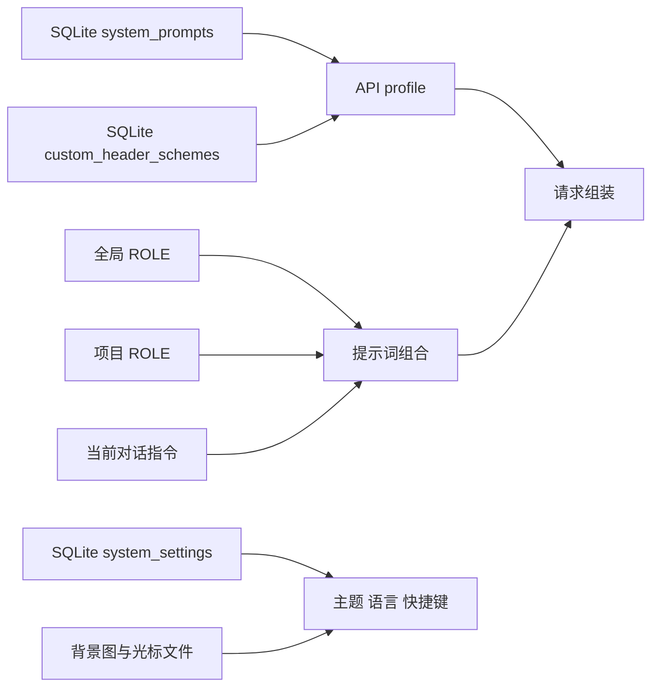

# 19-个性化、主题与快捷键

> 本指南说明 Snow App 的规则组合、请求配置、主题、语言和快捷键行为。设置侧栏当前包含 25 个设置页；本文涉及「系统提示词」（设置页 id：`system-prompt-settings`）、「个性化」（`personalization-settings`）、「自定义请求头」（`custom-headers-settings`）、「主题设置」（`theme-settings`）、「快捷键」（`keyboard-shortcuts-settings`）等页面。语言选择位于设置列表下方的独立区域，不是第 26 个设置页。

## 配置流与生效边界

渲染进程通过 preload API 与 IPC 访问主进程或 Rust 存储层。文件型规则保存在 `~/.snow/` 或工作区，结构化设置主要保存在 `~/.snowapp/snowapp.db`。修改规则不会重写历史消息；它主要影响后续提示词构建和下一次对话请求。

## 个性化规则

### 全局 ROLE

全局规则文件是 `~/.snow/ROLE.md`。个性化页面通过 preload → IPC 读取和保存该文件：

- 文件不存在时，编辑器显示空草稿；
- 保存时会创建缺失的 `~/.snow/` 目录；
- 全局规则适用于允许加载全局规则的项目；
- 规则内容可能影响模型行为，应像代码和配置一样审查后再保存。

### 项目 ROLE

项目规则位于 `<workspace>/ROLE.md`，只编辑当前激活项目。本地和 SSH 工作区都受支持；SSH 工作区由主进程通过远程访问链路读取和写入。

项目是否加载全局规则由 `<workspace>/.snow/settings.json` 中的 `role.includeGlobalRules` 控制。字段缺失时默认值为 `true`。

### 覆盖内置提示词

全局规则、项目规则编辑器（以及输入框的 ROLE.md 编辑弹窗）都提供「覆盖内置提示词」开关，对应各自作用域 `settings.json` 中 `role.overrideRoleIds` 是否包含 `active`（与 Snow CLI 兼容）：

- 关闭（默认）：规则替换内置提示词开头的角色描述，其余内置章节照常保留；
- 开启：仅对普通模式生效，规则内容替代整个内置提示词模板，平台命令、工作目录、日期以及工具相关的动态章节仍会追加；Plan / Goal / WorkFlow / WorkTree 模式带有明确的流程指导，不会被替换，规则仍按关闭时的方式嵌入；
- 开关不影响 API profile 中绑定的系统提示词：配置了它们时，仍由它们占据系统提示词位，内置提示词（开启后即规则内容）降级为第一条用户消息；
- 全局与项目规则同时加载时，任一作用域开启即生效；项目关闭「加载全局规则」后，全局开关对该项目不生效。

### 加载顺序与优先级

用户界面展示的组合顺序是：

1. 全局规则；
2. 项目规则；
3. 当前对话指令。

启用的范围都会被加载；只有发生冲突时，后出现的指令才优先。非冲突规则仍共同生效。项目切换后，应确认当前编辑器对应的工作区，避免把规则保存到错误项目。

## 系统提示词与 API profile

系统提示词模板保存在 SQLite 表 `system_prompts`，支持新增、编辑、启用、停用和删除，也可从 `~/.snow/system-prompt.json` 同步 Snow CLI 配置。模板具有 `global` 或 `project` 作用域。

API profile 的 `systemPromptIdsJson` 有三种状态：

| 值              | 行为                                  |
| --------------- | ------------------------------------- |
| 空字符串        | 继承全局启用的系统提示词              |
| `__DISABLED__`  | 此 profile 不使用用户配置的系统提示词 |
| JSON 字符串数组 | 绑定明确的系统提示词 ID 列表          |

运行时会按供应商协议放置生效的用户系统提示词：Chat Completions 使用 `system` 消息，Responses 使用 `instructions`，Anthropic 使用顶层 `system`，Gemini 使用 `systemInstruction`。只要存在用户系统提示词，它们会独占对应供应商的系统字段；Snow 内置 Agent 系统提示词不会被删除，而是降为首条 `user` 消息。没有用户系统提示词时，内置提示词仍占用供应商系统字段。因此 `__DISABLED__` 表示禁用用户模板，不表示移除 Snow 的内置 Agent 指令。

删除或停用模板前，应检查使用该模板的 profile。显式 ID 列表与“继承全局”不是同一语义。

## 自定义请求头

请求头方案保存在 SQLite 表 `custom_header_schemes`，支持新增、编辑、启用、停用和删除。同一方案内的请求头名称必须唯一，也可从 `~/.snow/custom-headers.json` 同步。

> **两个入口要分清**：`~/.snow/custom-headers.json` 只是 Snow CLI 兼容的同步源文件，
> 改它不会自动改变 App 实际发送的请求头（需在设置面板点「同步 Snow CLI 自定义请求头」）；
> App 的生效配置就是上面这张数据库表。让 AI 直接维护生效请求头可用
> `config-set scope=customHeaderSchemes key=<方案ID> value={name?, headers?, isActive?}`：
> `headers` 为 merge 语义（键值写 `null` 删除该头）、`isActive:true` 互斥激活该方案，
> 写完立即对后续 API 请求生效（进行中的请求不受影响）。

方案编辑器的请求头列表下方有「可用变量」提示，列出 6 种等价的会话 ID 写法（`{{session_id}}`、`{{sessionId}}`、`{{conversation_id}}`、`{{conversationId}}`、`${session_id}`、`${conversation_id}`）：点击任一变量会把它插入到请求头值的光标位置，可与其它文本组合使用。

API profile 的 `customHeaderSchemeId` 同样有三种状态：

| 值             | 行为               |
| -------------- | ------------------ |
| 空字符串       | 继承全局请求头方案 |
| `__DISABLED__` | 不添加自定义请求头 |
| 方案 ID        | 绑定指定请求头方案 |

自定义请求头会在应用先设置认证与协议头之后注入。空名称/空值会跳过，非法 HTTP header 名称或值会使请求失败；保留名称按大小写不敏感匹配，不能覆盖应用管理的值：

| 供应商协议                  | 不能由自定义方案覆盖的请求头                                                            |
| --------------------------- | --------------------------------------------------------------------------------------- |
| Chat Completions、Responses | `Authorization`、`Content-Type`、`Accept-Encoding`                                      |
| Anthropic                   | 上述三项以及 `X-API-Key`                                                                |
| Gemini                      | `Content-Type`、`Accept-Encoding`；API key 位于 URL 查询参数而不是 Authorization header |

### 请求头值中的会话变量

请求头值支持模板占位符 `{{session_id}}`：发送请求时，它会被替换为发送该请求的会话 ID（即该对话的 `conversation_id`，形如 `conv-<时间戳>-<进程号>`），并且可以与固定文本组合使用（例如 `snow-app-{{session_id}}`）。别名写法 `{{sessionId}}`、`{{conversation_id}}`、`${session_id}` 等效。

- 会话内请求都会展开为当前会话 ID：Chat Completions、Responses、Anthropic、Gemini、Interactions，以及会话摘要；子代理会话使用其自身的会话 ID。
- 无会话上下文的请求（获取模型列表、代码库审查、独立读图等）会省略该请求头，而不是发送字面量 `{{session_id}}`。
- 未识别的占位符保持原样，其余内容按原样发送。

> **安全警告：** 请求头可能包含 API key、Bearer token、Cookie 或其他秘密。不要分享原始配置文件、数据库、请求日志或包含请求头的截图；排障材料必须先脱敏。

## 主题设置

### 模式、预设与自定义颜色

主题模式支持 `system`、`light` 和 `dark`。可以选择内置预设，也可以分别维护亮色和暗色调色板。调整会实时预览，表单变化后以 1000 ms 防抖自动保存；恢复默认和应用 AI 配色会立即持久化。

主题配置以 `theme_settings` 记录在 SQLite `system_settings` 中，包含：

- `mode`、`presetId`；
- `custom.light` 与 `custom.dark` 调色板；
- `background`（来源、图片列表、轮播参数与不透明度 / 模糊）；
- `fontFamily`；
- `typography`（界面字号 / 正文字重 / 聊天正文字号 / 行高 / 代码字号）；
- `streamCursor`。

渲染进程还使用 localStorage 快速缓存主题，以减少启动时的主题闪烁；SQLite 仍是持久化设置来源。

### 背景、字体与流式光标

背景支持两种来源，二者互斥：

- **图片**：背景图以图片列表管理，列表最多 30 张。点击「添加图片」可在一次文件选择中多选若干张本地图片（`png`、`jpg`、`jpeg`、`gif`、`webp`、`bmp`、`svg`）；Snow App 会把每个文件复制到 `~/.snowapp/backgrounds/`，之后不再持续引用原始文件。列表以缩略图网格展示，可逐张移除；点击缩略图可把该图固定为背景并结束自动轮播；超过 30 张上限的图片会提示未加入。
- **宠物**：选择已安装的桌面宠物后，该宠物的 idle 动画会在界面顶层循环播放作为动态背景，并提供 20%–150% 的大小调节（相对窗口高度）；播放速度跟随「设置 → 桌面宠物」中的速度倍率。

渲染进程通过受控的 `theme-bg://` 协议读取图片资源。

两种来源共用启用状态、不透明度与 0–100 的模糊值；不透明度上限为 60%，并与模糊共同作用于整层背景。`background` 字段中的 `source` 标记当前来源，`petId` 与 `petScale` 仅在宠物来源下生效。

#### 自动轮播

图片列表支持自动轮播，可随时开关：

- **切换间隔**：10 秒 ~ 2 小时，可选 10 秒、30 秒、1 分钟、5 分钟、15 分钟、30 分钟、1 小时、2 小时，默认 5 分钟；
- **播放顺序**：「顺序」或「随机」，默认「顺序」；
- **切换效果**：切换时进行约 0.6 秒的交叉淡化过渡，并在切换前预加载下一张，避免出现空白；
- **运行范围**：轮播只在应用运行期间进行；
- **播放位置**：顺序模式下，下次启动应用或重新开启轮播时会从上次显示的那张图继续往后播放；随机模式下，每次开始播放都会随机挑一张作为起点；关闭轮播或点击缩略图固定某张图时，当前显示的那张图会被记住，重启后仍显示它；
- **单图与关闭**：列表只有一张图或未开启轮播时，背景保持静态，不会发生切换。

#### 历史图片与文件保留

添加过的背景图文件都会保留在应用管理的 `~/.snowapp/backgrounds/` 目录中，「历史图片」弹窗可查看这些文件，并把图片重新加入列表。文件是否从磁盘删除取决于操作位置：

| 操作                           | 列表     | `~/.snowapp/backgrounds/` 中的文件 |
| ------------------------------ | -------- | ---------------------------------- |
| 从当前列表移除一张图           | 移除该图 | 保留，可稍后从「历史图片」重新加入 |
| 重置主题                       | 清空     | 保留，可稍后从「历史图片」重新加入 |
| 在「历史图片」弹窗中删除一张图 | 移除该图 | 同时从磁盘删除，无法再重新加入     |

字体可选择系统默认或指定字体族。同一区域还提供排版设置：界面字号（12–18 px，13 px 为 100%，以整页缩放实现，等效 Electron `webFrame.setZoomFactor`）、正文字重（100–900，可自由填写）、聊天正文字号（12–20 px）、聊天正文行高（1.2–2.4）与代码字号（10–18 px，作用于聊天代码块与行内代码）；字号调整可用快捷键完成并即时持久化。流式光标支持：

- 默认脉冲圆点 `dot`；
- 内置 Lucide 图标 `lucide`；
- 自定义 SVG `custom`。

自定义 SVG 复制到 `~/.snowapp/stream-cursors/`。光标尺寸规范化到 8–48，默认值为 14；无效图标类型或缺少必要文件路径时会回退为圆点。

### AI 配色

AI 配色以背景列表中的第一张图为视觉输入。使用前必须选择 API profile，且该 profile 的高级模型需要支持视觉输入。生成结果应用后会立即写入主题设置。背景图会发送给所选模型处理，因此在使用私人图片前，应确认服务商的数据处理政策。

## 语言

支持 `en`、`zh-CN` 和 `zh-TW`。语言选择位于设置侧栏底部的独立区域。

- 快速缓存：renderer localStorage 的 `snow.locale`；
- 持久化来源：SQLite `system_settings` 中 code 为 `language` 的记录；
- 无 localStorage 缓存时，先读取数据库；
- 数据库也无有效值时，匹配浏览器语言，无法匹配则回退英文。

`~/.snow/language.json` 属于 Snow CLI/config 工具的配置域，不能视为当前 UI 语言的唯一事实来源。

## 桌面宠物

设置侧栏的「桌面宠物」页用于管理桌面宠物：安装来自 Codex App、Petdex 或
Snow App 的宠物包（`.zip`），选择活动宠物，并在唤醒（显示在桌面上）与关闭
（隐藏）之间切换；唤醒时可通过滑块调整显示大小（0.5–2 倍，默认 0.75）。
宠物会随 AI 工作实时做出反应。

Snow App 自带官方内置宠物（`resources/pets/*.zip`），首次启动即自动安装到
`~/.snowapp/pets/`，无需手动安装；若老用户此前已手动装过同 id 的宠物，安装时
会直接覆盖该目录，列表按 id 去重，不会出现重复条目。内置宠物不可卸载（列表中
不显示删除按钮），也不能被同 id 的手动安装包覆盖，数据清理同样会保留它。升级后
内置宠物会随应用版本或包内容变化自动更新；若宠物目录丢失，下次启动会自动补装
（标记文件 `~/.snowapp/builtin-pets.json`）。安装与解压由 Rust 后端完成，不阻塞主进程。

## 快捷键

### 默认绑定

`Mod` 表示平台主修饰键：macOS 为 Command，其他平台为 Control。

| 动作             | 默认键                           |
| ---------------- | -------------------------------- |
| 取消当前会话     | `Escape`                         |
| 打开搜索         | `Mod+F`                          |
| 打开备忘录       | `Mod+B`                          |
| 打开 TODO        | `Mod+T`                          |
| 切换项目         | `Mod+Backtick`                   |
| 打开项目浏览器   | `Mod+D`                          |
| 切换 API profile | macOS `Ctrl+P`；其他平台 `Alt+P` |
| 增大界面字号     | `Mod+=`                          |
| 减小界面字号     | `Mod+-`                          |
| 重置界面字号     | `Mod+0`                          |

以上快捷键均默认启用且 `foregroundOnly=true`，设置以 JSON 形式保存在 SQLite `system_settings` 的 `keyboard_shortcuts` 记录中。

### 重新绑定、冲突与作用域

每项快捷键可独立启用、重新绑定和恢复默认，页面也可恢复全部默认键。录制普通动作时按 `Esc` 会取消录制；录制“取消当前会话”时 `Esc` 是有效绑定。录制支持 **Shift 修饰键**（如 `Cmd/Ctrl+Shift+P`），会按事件转换、展示与匹配逻辑正确识别并保存。

页面会显示绑定冲突，但冲突提示不会自动替用户选择。运行时按动作顺序只触发第一个匹配项。局部组件可以接管某个动作，例如文件查看器聚焦时把搜索快捷键用于文内搜索。

“仅前台”开关会被持久化，但当前引擎基于 renderer 的 `document.keydown`。因此即使关闭该开关，快捷键仍只能在应用聚焦、能够收到键盘事件时工作；它不是系统级全局快捷键。

## 存储、生命周期与安全边界

| 数据                   | 位置                                                     | 生命周期                                                                         | 安全边界                                        |
| ---------------------- | -------------------------------------------------------- | -------------------------------------------------------------------------------- | ----------------------------------------------- |
| 全局 ROLE              | `~/.snow/ROLE.md`                                        | 持续保留，直到用户改写或删除                                                     | 可影响所有允许加载全局规则的项目                |
| 项目 ROLE 与开关       | `<workspace>/ROLE.md`、`<workspace>/.snow/settings.json` | 随工作区文件保留                                                                 | 仅当前项目；SSH 内容经过远程访问链路            |
| 系统提示词、请求头方案 | `~/.snowapp/snowapp.db`                                  | 持续保留，直到 UI 删除、数据库迁移或恢复                                         | 可能包含指令和秘密；数据库备份也属敏感材料      |
| 主题、语言、快捷键     | SQLite `system_settings`                                 | 持续保留，直到修改、重置或数据库替换                                             | localStorage 仅作启动缓存，不代替数据库事实来源 |
| 背景图、光标 SVG       | `~/.snowapp/backgrounds/`、`~/.snowapp/stream-cursors/`  | 复制后由应用管理；从列表移除或重置主题不删文件，仅在「历史图片」中删除时移除副本 | `theme-bg://` 只暴露受控本地资源                |

更完整的目录、备份和恢复边界参见[数据存储位置参考](../3-参考手册/4-数据存储位置.md)。

## 常见问题

### 修改 ROLE 后为什么旧消息没有变化？

ROLE 在后续提示词构建时读取，不会重写已保存的历史消息。请在下一次请求中验证行为。

### 关闭“仅前台”后，为什么切到其他应用仍不触发？

当前快捷键由渲染进程键盘事件驱动，应用失焦后收不到事件。该开关当前不提供操作系统级全局注册。

### 删除原背景图会导致主题失效吗？

不会。添加图片时文件已复制到 `~/.snowapp/backgrounds/`，并登记为历史图片；从列表移除或重置主题都不会删除磁盘副本，可以随时重新加入。只有在「历史图片」弹窗中删除该图时，副本才会从磁盘移除，之后无法再重新加入。

### 为什么 API profile 没有使用全局提示词或请求头？

检查 profile 是否为 `__DISABLED__` 或绑定了显式 ID。空字符串才表示继承全局配置。
