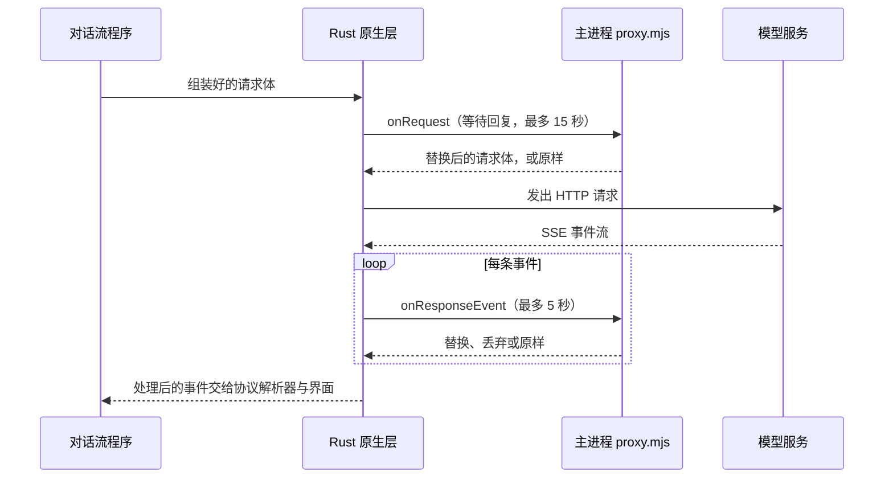

# 对话请求代理层：用脚本改写请求与响应

> 适用：Snow App 桌面端（Windows / macOS / Linux）。作用范围是经对话流（`createResponseStream`）发出的模型请求，包括主会话、子代理与上下文压缩；不包括标题摘要、图片生成、文件检索代理与代码库审查。

## 目标

- 模型请求体发出前，由你的脚本检查、补充或替换字段。
- 模型返回的每条 SSE 事件送达应用前，由你的脚本替换文本、改写字段或直接丢弃。
- 不修改应用源码，保存脚本文件即可生效，无需重启。

## 前置条件

- 会编写 JavaScript（ES 模块）。脚本运行在 Electron 主进程中，拥有 Node.js 全部权限，**只放入可信代码**。
- 不需要额外的设置项。只要脚本文件存在且导出了钩子，代理层就会生效。
- 请求体中包含完整的对话上下文，脚本能读到这些内容；请不要把它们写入不受控的日志或网络。

## 工作方式



请求阶段在每次对话请求发出前执行一次。响应阶段只有在脚本导出了 `onResponseEvent` 时才逐条执行；没有导出时，响应直接按原样处理，不增加额外开销。

## 操作步骤

1. 打开代理脚本。路径为 `~/.snowapp/request-proxy/proxy.mjs`（Windows 为 `C:\Users\<用户名>\.snowapp\request-proxy\proxy.mjs`）。首次启动应用时，文件若不存在会自动生成。
2. 文件内容默认是一份全部被注释掉的模板，此时没有任何请求或响应被改动。取消注释你需要的钩子并修改。
3. 保存文件。脚本会在下一次请求或下一条响应事件到达时自动重新加载，无需重启应用。
4. 发送一条消息，按下文的[验证](#验证)方法确认效果。

## 钩子契约

脚本是一个 ES 模块，只识别两个具名导出。未导出的钩子等同于不处理。

| 导出              | 调用时机                        | 参数                                                       | 返回值与含义                                                                                                        |
| ----------------- | ------------------------------- | ---------------------------------------------------------- | ------------------------------------------------------------------------------------------------------------------- |
| `onRequest`       | 每次对话请求发出前调用一次      | `{ body, context }`，`body` 为当前协议的请求 JSON          | 返回对象：替换整个请求体。返回 `undefined`：保持不变。                                                              |
| `onResponseEvent` | 每条 SSE 事件送达应用前调用一次 | `{ event, context }`，`event` 为原始事件文本，不含结尾空行 | 返回字符串：用该文本替换本事件，可包含多条事件（以空行分隔）。返回 `null`：丢弃本事件。返回 `undefined`：保持不变。 |

`context` 字段：

| 字段             | 类型            | 说明                                                                                                               |
| ---------------- | --------------- | ------------------------------------------------------------------------------------------------------------------ |
| `streamId`       | 字符串          | 本次对话流的标识，同一次回复的所有调用共享它。                                                                     |
| `conversationId` | 字符串或 `null` | 所属会话；新会话的首条请求可能为 `null`。                                                                          |
| `provider`       | 字符串          | 协议类型：`chat`、`responses`、`anthropic`、`gemini` 或 `interactions`。不同协议的请求体结构不同，修改前先判断它。 |

`context` 不包含接口地址、请求头与 API 密钥，脚本无法改变请求发往哪里，也无法读取凭据。

## 示例

### 示例一：修改请求体

只对 Chat Completions 协议追加一个参数，其他协议保持不变：

```js
export function onRequest({ body, context }) {
  if (context.provider !== "chat") return undefined;
  return { ...body, temperature: 0.2 };
}
```

注意：部分推理模型不接受 `temperature`，上游会返回 400。遇到这类错误，请撤销该字段或限定模型。

### 示例二：替换响应中的文本（安全写法）

响应事件是 JSON 文本。直接对整段事件做字符串替换，可能破坏 JSON 转义。推荐只解析 `data:` 行，修改后再序列化：

```js
export function onResponseEvent({ event, context }) {
  if (context.provider !== "chat") return undefined;
  return event
    .split("\n")
    .map((line) => {
      if (!line.startsWith("data:")) return line;
      const raw = line.slice("data:".length).trim();
      if (raw === "" || raw === "[DONE]") return line;
      let data;
      try {
        data = JSON.parse(raw);
      } catch {
        return line;
      }
      const delta = data.choices?.[0]?.delta;
      if (typeof delta?.content === "string") {
        delta.content = delta.content.replaceAll("旧词", "新词");
      }
      return `data: ${JSON.stringify(data)}`;
    })
    .join("\n");
}
```

注意：流式输出是按片段切分的，一个词可能被拆到两条事件里，单条事件内的替换无法覆盖跨事件的词。需要整词替换时，应在 `onRequest` 中约束输出，或接受这一限制。

### 示例三：丢弃某类事件

```js
export function onResponseEvent({ event, context }) {
  if (context.provider === "anthropic" && event.includes("event: ping")) {
    return null;
  }
  return undefined;
}
```

## 验证

- **请求是否被改动**：在 `onRequest` 中临时加入 `console.log(body)`。在开发模式（`npm run dev`）下，主进程的 `console` 输出会出现在启动终端里。验证后删除该行。不要在正式使用时打印整段请求体。
- **响应是否被改动**：在 `onResponseEvent` 中替换一个容易辨认的词，发送消息后观察界面。
- **脚本是否加载成功**：语法错误或导入失败时，脚本不会生效，请求与响应原样放行，错误会写入应用日志（见下一节）。

## 常见问题与恢复

| 现象                       | 原因                                                                                | 处理                                                                       |
| -------------------------- | ----------------------------------------------------------------------------------- | -------------------------------------------------------------------------- |
| 修改后没有变化             | 钩子仍被注释、导出名拼写错误（必须是 `onRequest` / `onResponseEvent`），或保存失败  | 检查导出语句是否取消了注释，名称是否完全一致，文件是否已保存。             |
| 应用日志中出现脚本加载错误 | 脚本有语法错误或顶层代码抛出异常                                                    | 修正后保存即可，下一次事件会自动重新加载。                                 |
| 请求返回 400               | 你添加或改写的字段不被该模型接受                                                    | 撤销该字段，或按 `context.provider` 与模型限定修改范围。                   |
| 响应文字断开或错位         | 替换发生在跨事件的片段上                                                            | 参见示例二的说明，避免跨事件的整词替换。                                   |
| 响应明显变慢或停止替换     | 单条事件的处理超过 5 秒，或脚本内有耗时操作。超时后，该次对话的后续事件不再交给脚本 | 让钩子保持同步、快速返回；不要在钩子中等待网络请求。                       |
| 请求发出前等待了较长时间   | 请求阶段脚本耗时较长，最多等待 15 秒，超时后按原样发出                              | 同上。                                                                     |
| 需要完全恢复原样           | 不再需要代理                                                                        | 删除 `proxy.mjs`，或把所有钩子重新注释掉。两种做法都会在下一次请求时生效。 |

应用日志可在 [用量统计与系统日志](20-用量统计与系统日志.md) 中查看。代理层的超时与调用失败由 Rust 写入模块 `api`、函数 `request_proxy`；脚本抛出的异常与加载错误由主进程写入模块 `requestProxy`。两者都在应用日志中。

## 行为边界

| 情形                                                                | 行为                                                     |
| ------------------------------------------------------------------- | -------------------------------------------------------- |
| 脚本文件不存在，或没有导出任何钩子                                  | 请求与响应完全不变。                                     |
| `onRequest` 抛出异常、返回非对象或超时                              | 使用原请求体发出。                                       |
| `onResponseEvent` 抛出异常或返回非字符串、非 `null`、非 `undefined` | 该事件原样放行。                                         |
| `onResponseEvent` 调用超时或调用失败                                | 该事件原样放行，并且本次对话的后续事件都不再交给脚本。   |
| 用户点击停止                                                        | 等待中的钩子立即结束，原样放行。                         |
| 非 SSE 响应（网关直接返回完整 JSON）                                | 流结束时，整个响应体作为一个事件交给 `onResponseEvent`。 |
| 原样放行的事件                                                      | 事件之间以空行分隔重新输出。                             |
| Responses 的 WebSocket 传输（`snowcfg.responsesWebSocket` 开启时）  | 不经过代理层，请求与响应都直接发送。                     |
| 标题摘要、图片生成、文件检索代理、代码库审查                        | 不经过代理层。                                           |

脚本只拿到当前请求体与当前响应事件，接口地址、请求头与凭据都不在其中。脚本运行在主进程中，能访问文件系统与网络；这与 [插件开发与安装](24-插件开发与安装.md) 中“本地代码拥有应用权限”的边界一致，安全模型见 [安全与信任边界](../3-参考手册/5-安全与信任边界.md)。

## 实现锚点

- `native/src/api/request_proxy.rs::transform_request`：请求体变换，超时、取消与失败直通。
- `native/src/api/request_proxy.rs::wrap_response_stream`：按 SSE 事件切分响应字节流，逐条交给脚本。
- `native/src/api/request_proxy.rs::with_session`：把会话上下文绑定到对话流 future 上。
- `native/src/exports/api.rs::create_response_stream`：对话流入口，绑定会话并把 `streamId` 与会话 ID 传入代理层。
- `native/src/api/chat/stream.rs::collect_chat_completions_stream`，以及 `anthropic`、`gemini`、`interactions`、`responses` 各自的 `collect_*` 函数：五种协议的请求变换与响应包装接入点。
- `src/main/requestProxy/requestProxy.ts::registerRequestProxy`：注册 Rust 回调、生成模板、按修改时间热重载脚本。
- `src/main/app/bootstrap.ts`：应用启动时调用 `registerRequestProxy`。
