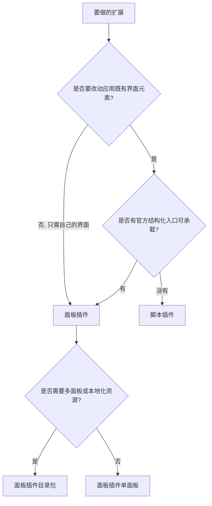

# 26-插件体系选择指引（面板插件与客户端脚本）

> 适用：Snow App 桌面端。本文回答「要给 Snow 加一个扩展，应该做成哪一类」，说明两类扩展的定位、能力边界、重叠场景的取舍规则与权限差异。具体做法见 [22-油猴脚本](22-油猴脚本.md)（脚本插件）与 [24-插件开发与安装](24-插件开发与安装.md)（面板插件）。

## 目标

- 判断一个扩展需求属于「在应用里开一块自己的地」还是「改造应用既有界面」，从而选定面板插件或脚本插件；
- 在两类能力重叠的场景（输入区控件、消息区内容）按固定规则取舍，避免写出会被界面重渲染破坏的扩展；
- 知道两类扩展各自的不可替代能力与权限边界，必要时组合使用。

## 前置条件

- 两类扩展都在侧边栏底部 **插件** 页面管理：**插件列表** 下的 **面板插件** 与 **脚本插件** 两个小标签分别是它们的入口；
- 需要写代码时先读对应指南：脚本插件见 [22-油猴脚本](22-油猴脚本.md) 的「客户端脚本（桌面窗口）」，面板插件见 [24-插件开发与安装](24-插件开发与安装.md)；
- 两类扩展都以**本地代码**运行（渲染进程或页面主世界），请只安装与编写可信来源的扩展。

## 1. 一句话定位

| 扩展形态 | 定位                                                                                     | 典型产出                                                   |
| -------- | ---------------------------------------------------------------------------------------- | ---------------------------------------------------------- |
| 面板插件 | 在应用里**开一块自己的地**：声明面板，由宿主提供容器、主题与本地化，插件在容器内自由渲染 | 右侧面板标签页、输入工具栏入口、消息结束卡片、工具调用卡片 |
| 脚本插件 | **改造应用既有界面**：按视图与区域匹配注入，用原生 DOM 改样式、加控件、挂钩子            | 界面美化、快捷按钮、跨域请求、复用油猴脚本                 |

两者不是同一件事的两种做法：面板插件改不到宿主界面，脚本插件没有面板容器与结构化插槽契约。

## 2. 能力对照

| 维度     | 面板插件                                                                                                                                      | 脚本插件（客户端 UI 脚本）                                                                                               |
| -------- | --------------------------------------------------------------------------------------------------------------------------------------------- | ------------------------------------------------------------------------------------------------------------------------ |
| 形态     | 本地目录包：`plugin.json` + 入口文件                                                                                                          | 单文件 Tampermonkey 兼容脚本（`// ==UserScript==` 头）                                                                   |
| 运行环境 | `renderMode: "esm"` 在主窗口渲染进程作为 ES 模块执行；`renderMode: "iframe"` 在独立沙箱文档中执行                                             | 默认每脚本一个隔离世界（沙箱档）；声明 `@snow-sandbox false` 或 `@grant unsafeWindow` 后改在页面主世界执行（完全权限档） |
| 界面能力 | 声明 `panels` 提供面板；`messageFooters` 接管消息结束插槽；`toolCallRenderers` 接管外部 MCP 工具卡片；`panels[].chatInput` 在输入工具栏加入口 | 按 `@snow-view` / `@snow-surface` 匹配后直接操作 DOM：`data-snow-anchor` 锚点只读，`data-snow-slot` 插槽可写挂载         |
| 宿主渲染 | 面板与贡献点都在 React 主树内渲染，保留主题与 i18n 上下文                                                                                     | 自行创建节点；宿主只负责在卸载时清理插槽与 `GM_addStyle` 样式                                                            |
| 数据读写 | `api.metadata`（36 个只读域）与 `api.write`（212 个写动作，按 `scope` 声明授权）                                                              | `snow.metadata` / `snow.write`，与面板插件同源同规则，受 `@snow-privacy` 约束                                            |
| 独有能力 | `api.ai`（仅 ESM，含提示词优化与安全草稿两阶段流程）、`api.storage` 私有存储、`api.assets` 资源解析、`locales` / `styles` 声明                | `GM_*` 全集（持久化值、标签页、通知、剪贴板、菜单命令）、`snow.client` 界面操作、`@run-at` 之外的零构建即改即生效        |
| 网络     | `api.net.fetch`（经主进程转发，需声明 `network`）                                                                                             | `GM_xmlhttpRequest`、`snow.fetch`；沙箱档下全局 `fetch` 已被替换为跨域实现                                               |
| 分发     | 目录包（含 Release 资产 zip），或插件市场一键安装（官方索引；社区通道按 `snow-plugins` 主题检索第三方仓库）                                   | `.user.js` 单文件，可从链接安装，也兼容插件市场的 `kind=script` 条目                                                     |
| 存储位置 | `~/.snowapp/plugins/<pluginId>/` + `app_plugins` 表                                                                                           | `~/.snowapp/browser-script/{script_id}.user.js` + `userscripts` 表（`target` 为 `client` / `all`）                       |

> 两类扩展共用同一套元数据域与写动作引擎（`api.metadata` 与 `snow.metadata`、`api.write` 与 `snow.write` 同源，均为 36 个只读域与 212 个写动作），因此数据能力不构成选型依据，界面形态与渲染方式才是。

## 3. 重叠区取舍规则

以下场景两类扩展都能做，但成本与稳定性差别很大，按此规则取舍：

| 需求                                         | 首选                                                       | 理由                                                                                            |
| -------------------------------------------- | ---------------------------------------------------------- | ----------------------------------------------------------------------------------------------- |
| 输入区常驻按钮或下拉菜单，且要读改写聊天草稿 | 面板插件（`panels[].chatInput: true` + `chatInputAction`） | Action 在 React 主树内执行，走宿主管理的草稿令牌与确认 / 还原流程；脚本只能对输入框做文本级操作 |
| 输入区一个「插入固定文本」之类的轻量按钮     | 脚本插件插槽 `chat.input.actions`                          | 实现成本最低，插槽内 append 的节点由宿主在卸载时清理                                            |
| 在每条 AI 回复下方追加信息                   | 面板插件 `messageFooters`                                  | 官方消息插槽契约，随消息列表虚拟化正确挂载；脚本追加的节点会被虚拟化重建清除                    |
| 给外部 MCP 工具渲染专属卡片                  | 面板插件 `toolCallRenderers`                               | 脚本插件没有该能力                                                                              |
| 调用应用内置的 AI 优化能力                   | 面板插件 `api.ai`（仅 ESM）                                | 脚本插件不提供 `ai` 能力                                                                        |
| 调整整体视觉：隐藏元素、改配色、调间距       | 脚本插件                                                   | 面板插件只能在自己的容器内渲染，改不到宿主 DOM                                                  |
| 往顶栏、侧栏、消息操作行插入简单控件         | 脚本插件插槽                                               | 单文件、零构建、保存即生效                                                                      |
| 临时试验，或复用 Tampermonkey 生态脚本       | 脚本插件                                                   | 兼容元数据头与 `GM_*`，可直接从链接安装                                                         |
| 需要多面板、多语言、独立样式文件与私有存储   | 面板插件                                                   | 目录包形态提供 `panels` / `locales` / `styles` / `api.storage`                                  |

规则可以概括为：**凡是官方提供了结构化入口的位置，用面板插件；官方没有入口、需要直接改宿主界面的，用脚本插件。**

## 4. 只有一类能做的场景

| 只能选   | 场景                                                                                                                       |
| -------- | -------------------------------------------------------------------------------------------------------------------------- |
| 面板插件 | 提供可打开的独立面板；接管消息结束插槽与工具调用卡片；使用 `api.ai` 的草稿确认流程；声明多语言与样式文件；使用插件私有存储 |
| 脚本插件 | 修改应用整体外观；往宿主任意锚点 / 插槽插入节点；复用 Tampermonkey 脚本与 `GM_*`；不打包目录、单文件即装即用               |

## 5. 组合使用

两类扩展可以同时安装并作用于同一界面，互不冲突：脚本插件负责界面层（布局、视觉、快捷入口），面板插件负责功能层（数据展示、写操作、结构化卡片）。脚本插件若需要展示复杂数据，优先把数据交给面板插件渲染，而不是在脚本里自行搭一套界面。

## 6. 权限与安全边界对比

| 维度     | 面板插件                                                                                                                      | 脚本插件                                                                    |
| -------- | ----------------------------------------------------------------------------------------------------------------------------- | --------------------------------------------------------------------------- |
| 默认权限 | `esm` 等同渲染进程本地代码（完全权限）；`iframe` 为沙箱文档，只能经桥请求 `metadata` / `write` / `storage` / `assets` / `net` | 沙箱档运行在隔离世界，拿不到 `window.snow` 等应用特权；声明后升为完全权限档 |
| 数据访问 | 敏感域须在 `plugin.json` 的 `privacy` 中声明，未声明即拒绝（返回 `denied`）                                                   | 敏感域须在 `@snow-privacy` 中声明，未声明即拒绝（返回 `denied`）            |
| 界面隔离 | 只能改自己的容器，天然不影响宿主界面                                                                                          | 可直接改宿主 DOM，改过的节点需要脚本自己在 `snow.onCleanup` 中还原          |
| 失败影响 | ESM 插件异常会冒泡到宿主渲染树，插件应自带错误边界                                                                            | 抛错会上报并累加错误计数，**连续失败 5 次自动禁用**                         |

需要最低风险时，优先选择面板插件的 `iframe` 渲染模式或脚本插件的沙箱档；完全权限档（`esm` 面板、主世界脚本）等价于本地代码，启用前请核对管理页面上的权限标签。

## 7. 验证

1. 面板插件：安装后在顶栏 **加号菜单** 的「插件」分组或右侧面板标签体系中打开其面板，确认数据与写操作生效；`messageFooters` / `toolCallRenderers` 贡献点需在对应消息或工具卡片上观察。
2. 脚本插件：在 **插件列表 → 脚本插件** 中启用后，切换到脚本声明的视图或区域，观察界面变化；报错会带 `[Snow Client Script]` 前缀打印，并在列表中累加 `错误 n 次`。
3. 停用后确认界面恢复：面板插件禁用后其面板不再出现在入口；脚本插件停用后宿主会清理插槽内容、`GM_addStyle` 样式与 `snow.onCleanup` 回调。

## 8. 常见问题与恢复

| 现象                                   | 排查                                                                                                          |
| -------------------------------------- | ------------------------------------------------------------------------------------------------------------- |
| 同一需求两种做法都能实现，不确定选哪个 | 回到第 3 节的取舍规则：先看该位置是否有官方结构化入口                                                         |
| 脚本改过的节点在界面重渲染后消失       | 预期现象。用 `MutationObserver` 侦听重挂，或改用面板插件的结构化贡献点                                        |
| 脚本在切换视图后失效                   | 非 `@snow-scope global` 的脚本随视图离开而卸载；常驻请声明 `global`，或在 `snow.on('view-enter', ...)` 中重建 |
| 沙箱档脚本读不到 `window.snow`         | 属预期行为；用 `snow.metadata` / `snow.write` 并声明 `@snow-privacy`，确实需要原始特权再升为完全权限档        |
| 脚本被自动禁用                         | 连续失败 5 次触发；修复后手动重新启用                                                                         |
| 面板插件的面板没有出现                 | 确认插件处于启用状态，并在加号菜单的「插件」分组中查找；修改过 `plugin.json` 后需要「重新读取清单」           |

## 实现锚点

- 面板插件清单解析（`panels` / `messageFooters` / `toolCallRenderers` / `chatInput` 贡献点）：`src/renderer/plugins/manifest.ts::normalizePanels`、`::normalizeMessageFooters`、`::normalizeToolCallRenderers`
- 面板插件运行时 API（`metadata` / `write` / `storage` / `ai` / `net` / `assets` / `ui`）：`src/renderer/plugins/pluginApi.ts::createPluginApi`
- 只读元数据域定义：`src/renderer/plugins/metadata/domains.ts`；写动作定义与授权校验：`src/renderer/plugins/writes/index.ts::executeWrite`
- iframe 面板桥：`src/renderer/plugins/pluginIframeBridge.js`；面板宿主：`src/renderer/components/rightPanel/PluginPanelContent.tsx`
- 脚本插件宿主（隔离世界注入、`GM_*` 与 `snow` shim、锚点与插槽、cleanup）：`src/preload/clientScriptHost.ts::initClientScriptHost`
- 脚本插件匹配与推送：`src/main/app/userscriptSyncStore.ts::matchesClientContext`、`::applyClientScripts`
- 脚本元数据解析（`@snow-target` / `@snow-view` / `@snow-surface` / `@snow-scope` / `@snow-sandbox` / `@snow-privacy`）：`native/src/storage/userscripts.rs::parse_meta`
- 管理界面：`src/renderer/components/sidebar/PluginsPanel.tsx`、`src/renderer/components/sidebar/PluginScriptsSection.tsx`
