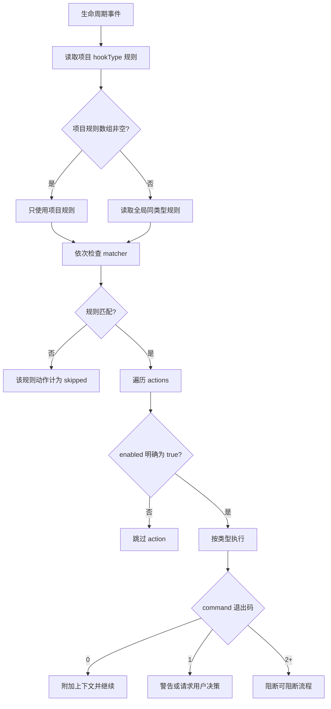
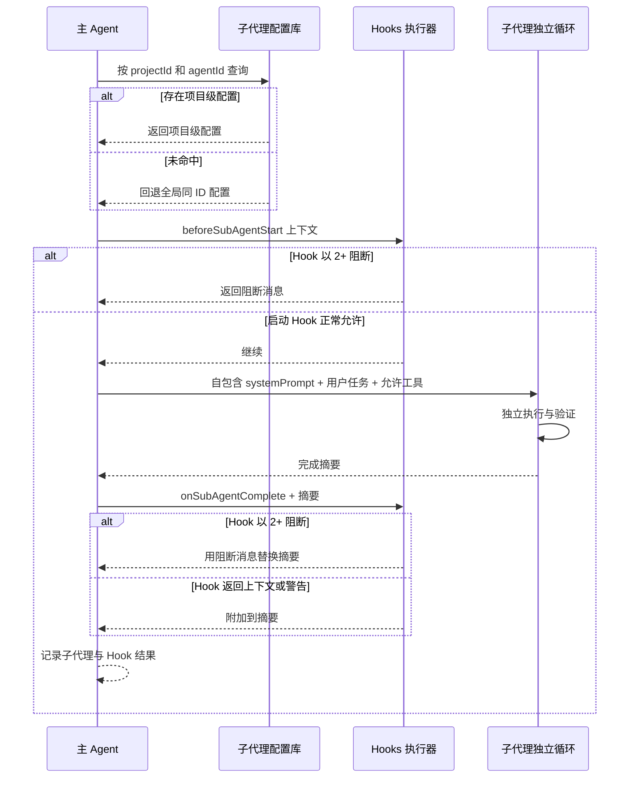

# 5-配置 Hooks 与子代理

Snow App 的 Hooks 和子代理配置存储在应用 SQLite 数据库中，与设置 UI 同源。Agent 可通过内置 `config` 服务读写，成功后立即生效。

## 1. Hooks

### 1.1 作用域与有效规则

- 全局 Hook 对所有项目可用；项目 Hook 需要 `projectId`；
- 执行某个 `hookType` 时，若该项目有**非空规则数组**，使用项目规则；否则回退同类型全局规则；
- 项目规则不会与全局规则合并；即使项目规则中的动作全部禁用，只要规则数组非空，也会阻止回退全局规则；
- 每个 action 只有在 **`enabled` 明确等于 `true`** 时才执行。字段缺省、`null` 或 `false` 都会跳过。设置 UI 保存时会显式写入该字段，通过 config 手写时也必须写。

### 1.2 Hook 类型

| `hookType`            | 触发时机                         | 允许的 action        |
| --------------------- | -------------------------------- | -------------------- |
| `onUserMessage`       | 用户消息进入 AI 前               | `command`、`context` |
| `beforeToolCall`      | 工具调用前                       | `command`            |
| `toolConfirmation`    | 工具进入确认流程时               | `command`            |
| `afterToolCall`       | 工具调用完成后                   | `command`            |
| `onSubAgentComplete`  | 子代理完成后                     | `command`、`prompt`  |
| `beforeSubAgentStart` | 子代理启动前                     | `command`、`context` |
| `beforeCompress`      | 上下文压缩前                     | `command`            |
| `onSessionStart`      | 打开已有会话时；fire-and-forget  | `command`、`context` |
| `onStop`              | 会话停止/清理时；fire-and-forget | `command`、`prompt`  |

> `prompt` 是合法配置类型，但当前 native executor 不发起模型调用，而是返回“不支持”的失败记录。不要依赖 `prompt` action 实现生产自动化；优先使用可验证的 `command`，或在允许的触发点使用 `context`。`beforeSubAgentStart` 的 context 目前会被记录，但调用方不会把它追加到子代理 prompt。

### 1.3 Rule 与 action 字段

```json
{
  "description": "为发布检查注入项目规则",
  "matcher": "toolName:bash-*",
  "hooks": [
    {
      "type": "command",
      "command": "node scripts/check-release.mjs",
      "timeout": 5000,
      "enabled": true
    }
  ]
}
```

| 字段          | 位置    | 说明                                                                                                           |
| ------------- | ------- | -------------------------------------------------------------------------------------------------------------- |
| `description` | rule    | 必须存在；建议说明意图和失败影响。                                                                             |
| `matcher`     | rule    | 可选。逗号分隔表示 OR；支持 `key:glob`，如 `toolName:bash-*`；无 key 时优先匹配 `toolName`，再检查上下文文本。 |
| `hooks`       | rule    | 必填 action 数组。                                                                                             |
| `type`        | action  | `command`、`context` 或允许位置的 `prompt`。                                                                   |
| `command`     | command | 通过终端设置中选择的 shell 执行。                                                                              |
| `content`     | context | 静态文本；JSON 中的 `additionalContext` 或 `prompt` 字段会被提取，否则使用全文。                               |
| `prompt`      | prompt  | 当前 native executor 不执行模型调用。                                                                          |
| `timeout`     | command | 毫秒；缺省 `5000`。超时会终止子进程并返回错误。                                                                |
| `enabled`     | action  | **执行必需为 `true`**；缺省不会执行。                                                                          |

command action 会把事件上下文 JSON 写入 stdin，并在上下文包含 `cwd` 时使用该目录。stdout/stderr 按退出码解释：

| 退出码              | 结果                                                                                            |
| ------------------- | ----------------------------------------------------------------------------------------------- |
| `0`                 | 通过；非空 stdout 成为附加上下文。stdout 若为 JSON，可从 `additionalContext` 或 `prompt` 提取。 |
| `1`                 | 软警告；记录日志。stdout 为 `{"decision":{"message":"..."}}` 时，请求交互式用户决策。           |
| `2+` 或无有效退出码 | 阻断当前可阻断流程，优先展示 stderr，其次 stdout。                                              |

`onSessionStart` 与 `onStop` 是 fire-and-forget：调用方会把交互式决策降级为普通警告，不能依赖它们阻断流程。

### 1.4 Hooks 执行流程



### 1.5 通过 UI 配置

1. 打开 **设置 → Hooks 设置**（设置页 id：`hooks-settings`）；
2. 选择全局或项目范围；
3. 选择 `hookType`，添加规则与动作；
4. 确认每个应执行动作的开关已打开；
5. 保存并用低风险事件测试；
6. 查看 Hook 执行记录与应用日志。

### 1.6 通过 `config` 配置

全局 command Hook：

```jsonc
config-set scope=hooks key=beforeToolCall value={
  "rules": [
    {
      "description": "运行只读工具审计",
      "matcher": "toolName:filesystem-*",
      "hooks": [
        {
          "type": "command",
          "command": "node scripts/audit-tool-call.mjs",
          "timeout": 5000,
          "enabled": true
        }
      ]
    }
  ]
}
```

项目 context Hook：

```jsonc
config-set scope=hooks key=onUserMessage projectId=<projectId> value={
  "rules": [
    {
      "description": "注入当前项目技术栈",
      "hooks": [
        {
          "type": "context",
          "content": "本项目使用 Electron、React、TypeScript 与 Rust。",
          "enabled": true
        }
      ]
    }
  ]
}
```

包含多个 action 时，每一个都显式设置 `enabled`：

```json
{
  "rules": [
    {
      "description": "压缩前检查并记录上下文",
      "hooks": [
        {
          "type": "command",
          "command": "node scripts/check-context.mjs",
          "timeout": 5000,
          "enabled": true
        },
        {
          "type": "command",
          "command": "node scripts/write-audit.mjs",
          "timeout": 5000,
          "enabled": false
        }
      ]
    }
  ]
}
```

推荐流程：

1. `config-list scope=hooks projectId=<projectId>` 查看现状和 `guidance`；
2. `config-get scope=hooks key=<hookType> projectId=<projectId>` 保存当前值；
3. `config-set` 写入完整 `rules`；
4. 立即 `config-get` 回读，逐个检查 `enabled`；
5. 用低风险事件测试退出码与 matcher；
6. `config-delete` 前展示 scope、key、projectId 和影响并取得明确确认。

Hook 数据库写入会创建写入期间的临时备份，成功后删除本次备份；不要把它当持久历史。

## 2. 子代理

### 2.1 配置字段与作用域

子代理通过 `sub-agents-activate` 运行在独立执行循环中，没有主对话历史。配置字段：

| 字段            | 说明                                                                                                                                                                          |
| --------------- | ----------------------------------------------------------------------------------------------------------------------------------------------------------------------------- |
| `name`          | 展示名称，必填。                                                                                                                                                              |
| `description`   | 告诉主 Agent 何时委派。                                                                                                                                                       |
| `systemPrompt`  | 必须自包含：使命、输入、流程、工具、安全边界和输出。                                                                                                                          |
| `toolsJson`     | JSON 字符串或工具名数组。`["*"]` 表示当前项目全部可用工具；显式清单至少包含一个读取类工具（`filesystem-read` 或 `grep-search`），空数组会被拒绝。                             |
| `configProfile` | 留空时继承启动它的主会话本次运行所用 API Profile 和当前模型；非空时固定使用指定 Profile。                                                                                     |
| `model`         | 仅固定 Profile 时生效；非空时固定模型，省略、留空或 trim 后为空时使用该 Profile 的 `advancedModel`。若该 Profile 的 `advancedModel` 也为空则激活失败，不会回退 `basicModel`。 |

激活时先查当前项目的同 ID 配置，未命中才回退全局。内置 `agent_general` 不可通过 config 修改或删除。

主 Agent 的系统提示词会**动态注入当前可用的子代理清单**（含 `agentId`、名称与用途描述）。调用 `sub-agents-activate` 时，主 Agent 应从清单中选择最匹配任务的 `agentId`——存在更合适的配置时**不得默认使用内置 `agent_general`**（它只是通用兜底，仅在无更匹配配置时使用）。清单遵循与激活一致的解析规则：**当前项目的项目级子代理优先**（同 `agentId` 时覆盖全局），未配置项目级的再显示全局/内置。其他项目的子代理不注入。修改配置后新会话立即生效。

启动前会一次性校验工具清单格式、Profile 和模型，并生成运行快照。普通循环、工具递归、自动压缩和压缩后续跑都复用该快照，不会在每轮跟随全局配置变化。每次请求仍按固定 Profile 名读取最新凭证，但 Profile 被删除时会严格失败，不会切换到其他供应商。子会话会持久化启动时实际使用的 Profile 和模型，因此历史展示不受后续子代理/API 配置修改影响。

工具规则：

- 在项目会话中省略 `projectId` 时会自动使用当前项目，结果是项目级子代理；要创建**全局**子代理，请显式传入 `projectId=""`；
- 全局子代理的显式工具清单候选来自系统服务与全局 MCP 服务，与项目无关，不必先选择项目；项目级子代理的候选是该项目已启用的工具；
- `["*"]` 在运行时展开为当前项目全部可用工具；
- 显式清单必须包含 `filesystem-read` 或 `grep-search` 之一，否则保存失败；
- 通过 config 写入项目级子代理时，工具名必须是内置工具，或属于已配置且启用的 MCP 服务器；全局子代理保存时不做项目校验；
- 运行时只使用当前对话项目中实际可用的工具。配置了却被全局或项目禁用、不可用或已不存在的工具会被跳过并记录日志，子代理用其余工具继续运行，不会报错，也不会扩大权限。

### 2.2 子代理会话视图

子代理运行时以独立会话呈现，打开该会话可看到：

- **顶部标题**：显示**阶段名称**（激活时 prompt 截断到 80 字符，即该子代理被派发的任务阶段）替代项目名；副标题标注**由哪个主会话启动**；
- **信息卡片**：消息列表上方展示 `agentName` 徽章、阶段标题、**跳转主会话**按钮，以及**完整提示词**（默认 3 行截断，悬停显示全文）；
- **数据来源**：会话记录 `title` / `subAgentName` + 首条用户消息（prompt）+ 父会话标题（异步获取）。

### 2.3 通过 UI 配置

1. 打开 **设置 → 子代理设置**（设置页 id：`sub-agent-settings`）；
2. 选择全局或项目范围；
3. 填写名称、描述和完整 system prompt；
4. 在「MCP 工具」列表中至少勾选一个读取类工具（`filesystem-read` 或 `grep-search`）。全局 Tab 列出系统服务与全局 MCP 服务的工具，与当前项目无关，不必先选择项目；项目 Tab 只列出当前项目已启用的工具。界面没有「全部工具」开关，`["*"]` 需通过 config 写入；
5. 保持“跟随主会话（推荐）”，或选择固定 API 配置；固定后可再选择独立模型，留空则使用该配置的高级模型；
6. 保存后，从主对话发起一个边界清晰的测试任务。

### 2.4 通过 `config` 配置

全局子代理示例（`projectId=""` 表示全局）：

```jsonc
config-set scope=subAgents key=agent_readonly_reviewer projectId="" value={
  "name": "只读审查员",
  "description": "需要独立审查并返回问题清单时使用",
  "systemPrompt": "你是只读审查员。先验证输入和文件，再按严重级别输出问题与证据。不得修改文件、运行命令或推测缺失业务规则。工具不可用时说明无法验证的部分。",
  "toolsJson": ["filesystem-read", "grep-search"],
  "configProfile": "",
  "model": ""
}
```

项目级显式工具示例：

```jsonc
config-set scope=subAgents key=agent_project_reviewer projectId=<projectId> value={
  "name": "项目审查员",
  "description": "审查当前项目代码并返回带路径的发现",
  "systemPrompt": "你是当前项目的只读代码审查员。使用允许工具读取事实，按严重级别、文件路径、证据和修复建议输出；不得修改文件。",
  "toolsJson": [
    "filesystem-read",
    "grep-search",
    "lsp-symbols"
  ],
  "configProfile": "",
  "model": ""
}
```

写入前先 `config-list scope=subAgents projectId=<projectId>` 获取 guidance 和当前工具环境；写入后 `config-get` 回读。`config-delete` 同样需要用户明确确认。

### 2.5 子代理与 Hooks 时序



注意：`beforeSubAgentStart` 调用抛出异常时，受理失败，不会继续启动子代理，也不会返回 accepted。正常返回的 Hook 决策仍按现有退出码语义处理；安全阻断应明确返回 `2+`，不要依赖异常代替决策。

### 2.6 子代理会话恢复与同会话通信

- **重启后查询与显式继续**：有项目持久绑定时，会话及运行结果在重启后保留；未终态运行变为 `interrupted`，不会自动续跑。`sub-agents-listSubAgents` 列出当前父会话的子代理与实际运行状态，`sub-agents-getResult` 按 `runId` 查询结果；`sub-agents-continue` 根据保存的配置与完整会话历史启动**新的**运行，原配置缺失时明确失败，不静默替换。无项目旧同步路径仍是运行期记录；
- **同会话通信**：`sub-agents-listTeammates` 查询当前会话中仍在运行的子代理，`sub-agents-sendMessage` 向其投递消息（以 Pending 消息在对方当前轮次结束时送达，并带发送者身份前缀）；并行子代理之间可直接协作，无需经主会话中转；
- **会话隔离**：以上工具只对**当前会话**生效——`listTeammates` 不暴露其他会话的子代理，`sendMessage`/`continue` 跨会话调用会被拒绝。

### 2.7 同步兼容的异步运行

在「设置 → 子代理设置 → 运行限制」选择「子代理执行方式」：**默认为同步**，父工具等待最终结果；选择异步后，父工具只等待受理回执即可继续无依赖工作。该选择全局生效，是强制执行方式：工具入参 `executionMode` 不能覆盖它，不影响已经受理的运行。**忙碌目标的 continue 仍立即返回消息排队回执**，不改变目标原运行方式。以下异步示例需先在设置页选择异步；不支持异步的入口明确拒绝，不静默改成同步。

模型请求也随设置精简工具：同步默认只携带 activate、listSubAgents、continue，异步且有项目绑定时才增加 getResult、wait、cancel。切回同步后，当前父会话仍有异步任务时保留必要管理工具；任务全部结束后收回 wait/cancel，仅为已有异步历史保留 getResult。工作流节点不暴露异步管理工具，异步设置下也不暴露无法执行的激活／继续入口。设置从下一次模型请求生效，不强停已有任务，不更改用户的 MCP 开关或授权；MCP 设置目录仍可显示完整注册工具。同步批量并行与子代理队友通信不受影响。

```json
{
  "agentId": "agent_general",
  "summary": "只读目录检查",
  "prompt": "只读取当前项目的 package.json，概括构建命令；不要运行命令或修改文件。",
  "executionMode": "async"
}
```

使用 `sub-agents-activate` 提交上例。成功受理返回 `kind: "accepted"`、`runId`、`conversationId`、`runStatus`，**不表示完成**。配置、权限、启动 Hook 和持久受理失败不会返回 accepted。桌面主会话及已登记的独立会话窗口复用宿主运行机制；异步需实际项目/工作区绑定。无项目旧同步路径保留 legacy 行为；工作流节点只支持同步，异步请求明确拒绝。应用退出后不继续运行。

| 工具                       | 参数与语义                                                                                                                                                                                                       |
| -------------------------- | ---------------------------------------------------------------------------------------------------------------------------------------------------------------------------------------------------------------- |
| `sub-agents-continue`      | `{conversationId,message,executionMode?,requestId?,acceptance?}`；忙碌时只把消息排入当前 run，async 回 `kind: "message_queued"`；终态时显式继续创建新 run 并保留历史。未消费消息留在原子会话，不转成父代理授权。 |
| `sub-agents-getResult`     | `{runId,offset?,limit?}`；运行中返回真实状态，终态返回 outcome。摘要默认每页 16000 个 Unicode 字符，limit 为 1–64000，offset 非负；`summaryPage.nextOffset` 可继续取回，错误/验收元数据不截断。                  |
| `sub-agents-wait`          | `{runIds,mode?:"any"或"all",timeoutMs?}`；1–32 个唯一 ID，默认 any/30000ms，timeoutMs 为 0–120000 整数。统一截止时间，超时不取消原运行；未知或跨父会话/项目 ID 报错。不要无止境轮询。                            |
| `sub-agents-cancel`        | `{runId}`；区分 requested、confirmed、already_terminal、too_late。请求不等于确认停止；finalizing 赢得竞争时 too_late；不撤销已发生的文件或外部副作用。                                                           |
| `sub-agents-listSubAgents` | 保留原字段，增量给出 active/latest run 身份与投递状态；旧记录不伪造 run、结果或验收证据。                                                                                                                        |

`requestId` 标识一次逻辑操作：模型未传时宿主从稳定工具调用身份派生；UI 为同一次操作生成并复用 UUID。回执未知后的重试必须复用原 ID 和原输入；有意再次执行才用新 ID。相同输入回原 run/消息，不同输入明确冲突；不会因目标从忙碌变终态而重复派发。

状态依次区分 queued（等名额）、running、waiting_input（去实际子会话处理授权/提问/失败决策）、finalizing、cancelling，以及 completed/failed/cancelled/interrupted。**completed 和 acceptanceSatisfied 分开**；验收缺项不是全部成功。卡片中的“派发工具完成”也不是后台任务完成。

同步与异步共用原有激活／继续卡片、会话树与运行详情；同步等待最终结果，异步先返回受理回执。卡片头部区分派发状态、实际执行方式和运行状态，不把同步最终结果误标为仅受理。wait/getResult/cancel 使用紧凑状态卡片，不再将嵌套 run 和摘要 JSON 展成横向表格；参数与结果以按需展开的字段卡片展示，不提供原始 JSON 视图；验收报告按状态、观察和证据分项呈现，卡片颜色与圆角跟随当前页面主题。等待执行期间按原父会话和精确 runId 订阅真实运行记录，不额外派发等待或轮询工具；等待结束后保留此次观测状态，不用后来的运行状态改写旧回执。等待超时单独标识，不标为取消或失败。结果摘要可展开，分页未完整时明确标识；运行详情按需读取并复用原有导航与控制。运行设置在宽面板为等宽双栏，窄面板自动单栏，不改变保存语义。

异步结果先持久结算再通知：父忙时在完整工具屏障后消费；父闲且原委派任务开放时可启动内部处理回合；用户停止、关闭任务或开始新用户任务后，旧结果保留但不隐式续跑原任务。内部结果不是新用户消息，也不是 Plan 审批或新授权。`received` 仅表示已持久加入父输入，不声称模型理解。同步最终回包及已观察的 get/wait 与自动通知按事件身份去重，UI 查询不确认模型接收。

重启或执行 owner 丢失时非终态 run 标为 interrupted，不冒充用户取消，不自动重放；显式继续生成新 run，固定配置缺失则失败、不换供应商。删除/归档先关闭新受理与唤醒，停止并等待 owner，再物理清理；失败保留门禁，显式重试，不假称删除成功。归档保留完整 run 结果与身份，恢复不重新开放历史任务或重放运行。

定位时记录时间及 `runId`/`eventId`/`interactionId`，在系统日志中查 `sub-agents` 模块，区分受理、执行、结算、接收和唤醒阶段。不要粘贴 API key、Cookie、完整敏感 prompt。界面/实际端到端效果需在新 native 构建并重启后验收，工程检查不等同手测通过。

### 2.8 结果证据与取消归因

- `summary` 是子代理末轮最终正文，不是完整会话转录；工具调用间的逐项报告应在子会话查看。分页只对最终正文按 Unicode 字符切片，不能取回未被最终正文包含的历史。
- `wait(any)` 和 `wait(all)` 都返回所有请求 run 的状态快照；前者至少一个终态便可满足，后者须全部终态。不能按 `results` 数量判断 any/all，超时不取消运行。
- 验收清单的宿主校验保证证据 ID 来自该子会话日志，不保证证据与条目的语义相关性或业务事实正确。主控仍需核对真实工具状态与直接相关内容，不把读取成功用于背书未验证条目。
- 新取消记录可含 `cancellation: {source, requestedAt}`，同步最终 outcome、异步 get/wait、取消回执和日志保留该字段。source 区分 `cancel_tool`、`parent_stop`、`conversation_stop`、`ui_cancel`、`deletion`、`runtime_abort`、`unspecified`；时间由持久层在首次受理时记录为 UTC epoch milliseconds。后续重试保留首次归因，`already_terminal`/`too_late` 不新增或覆盖来源。旧记录缺失字段表示未记录，不能根据中断文案推断为父停止或用户操作。公共 cancel 工具仍只传 runId，不接受模型指定来源。
- `message_queued` 只证明入队；结果事件的 `deliveryStatus: received` 只证明持久合入父输入，两者不是补充消息的模型理解回执。两个 activate 创建独立子会话，不是同目标 RUN_BUSY 测试。

详见 [取消归因与验收边界 ADR](../4-架构与开发/14-子代理取消归因与验收边界ADR.md)。新元数据需应用加载新 native/renderer 后生效，构建与隔离探针不能替代重启、跨窗口或删除的真实端到端验证。

## 3. 验证与排错

| 症状                                         | 检查                                                                                                   |
| -------------------------------------------- | ------------------------------------------------------------------------------------------------------ |
| Hook 保存成功但从不执行                      | action 是否显式 `"enabled": true`；缺省值会被 native executor 跳过。                                   |
| 项目 Hook 未回退全局                         | 项目规则数组非空即取代全局；删除项目配置或使用空规则数组才会回退。                                     |
| matcher 不命中                               | 核对上下文键名和完整工具名；需要时使用 `toolName:<glob>`。                                             |
| command 超时                                 | 默认 5000 ms；检查 shell、PATH、cwd、stdin 读取和合理的正数 `timeout`。                                |
| 退出 1 没有决策卡                            | stdout 必须是有效 JSON，且包含字符串 `decision.message`；fire-and-forget Hook 只显示警告。             |
| prompt action 没有效果                       | 当前 native executor 不执行 prompt 模型调用；改用 command 或受支持的 context。                         |
| context 未进入子代理 prompt                  | `beforeSubAgentStart` 当前只记录结果，不拼接子代理 prompt；把必需内容写入子代理 `systemPrompt`。       |
| 保存子代理被拒（工具清单为空或缺少读取工具） | 显式清单至少包含 `filesystem-read` 或 `grep-search`；需要全部可用工具时使用 `["*"]`。                  |
| 项目关闭服务后子代理不再使用该服务的工具     | 运行时按当前对话项目的开关跳过该工具并记录日志；在该项目重新启用服务即可恢复，全局子代理配置本身不变。 |
| 全局子代理找不到项目专属服务的工具           | 全局子代理只列出系统服务与全局 MCP 服务的工具；项目专属服务的工具请使用项目级子代理。                  |
| 子代理找不到工具                             | 使用当前项目的完整启用工具名，检查 MCP 服务器与工具开关（全局+项目）。                                 |
| 子代理行为依赖主对话                         | 子代理没有主会话历史；把上下文放进任务 prompt 或自包含 `systemPrompt`。                                |
| 同 ID 激活了错误配置                         | 项目级优先于全局；分别 `config-get` 并核对 `projectId`。                                               |
